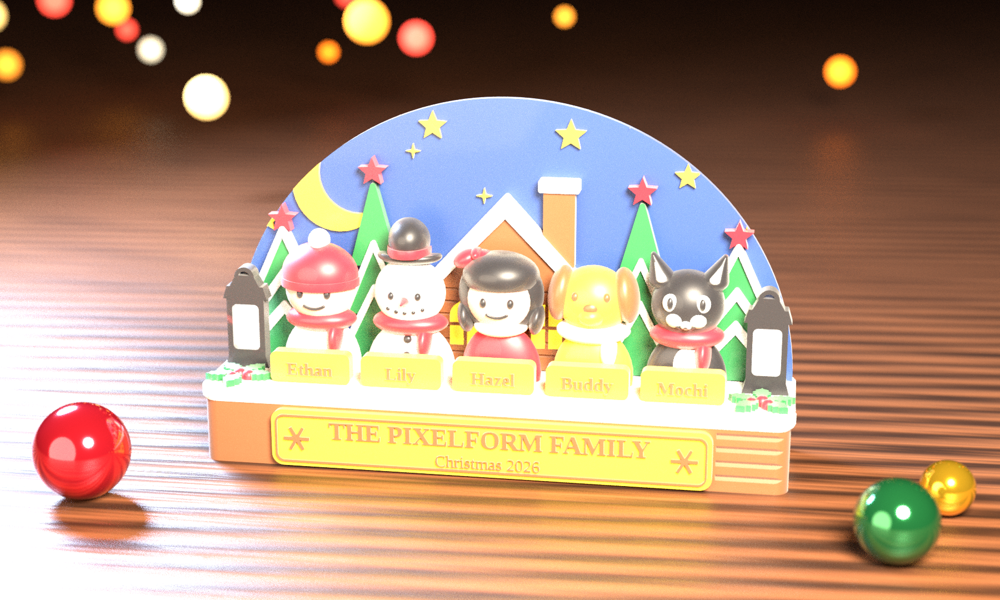
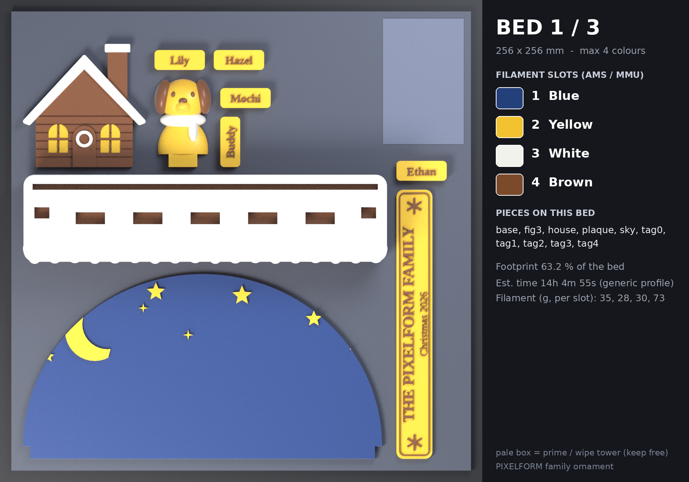
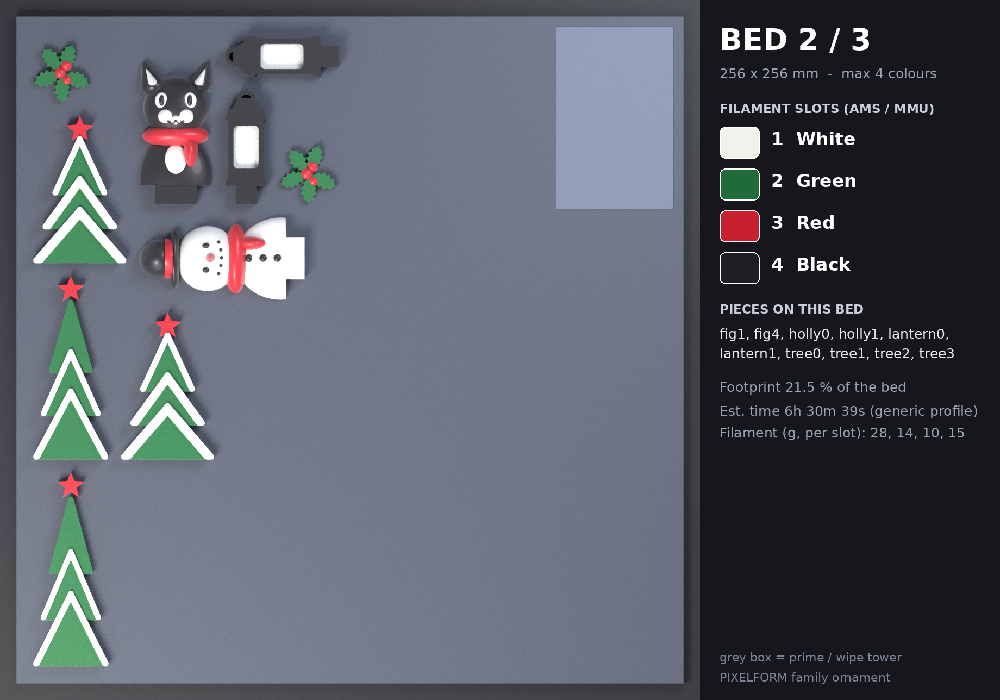
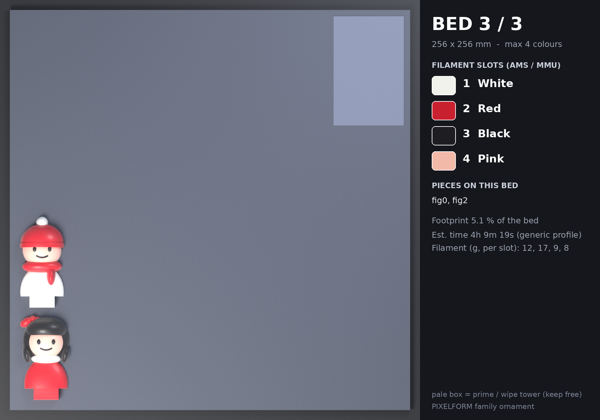
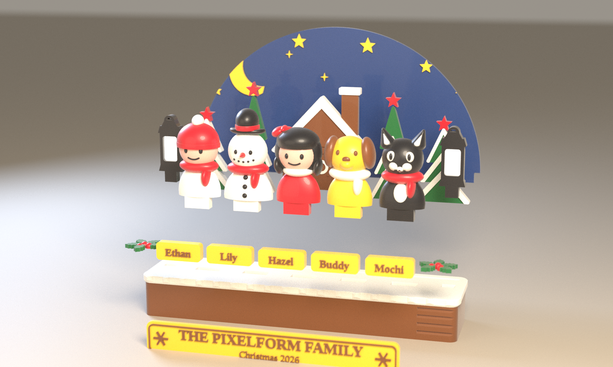
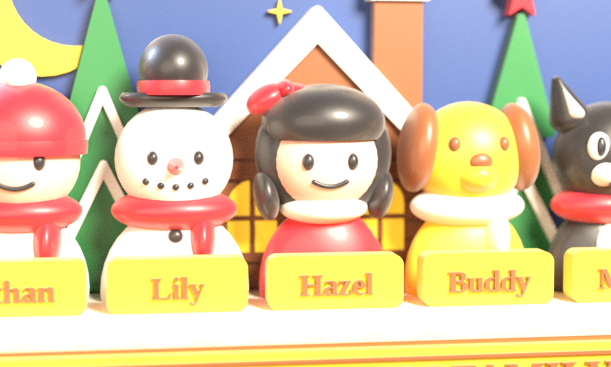

# 🎄 THE PIXELFORM FAMILY — Christmas 2026

맞춤형 가족 크리스마스 장식품 (OpenSCAD 모델 + Blender 렌더 + **베드별 색상 프린트 레이아웃**).
눈 내리는 밤, 달과 별이 뜬 아치 안에 집·나무·랜턴, 그 앞에 가족 다섯(Ethan · Lily · Hazel · Buddy · Mochi)이 서 있고
눈 덮인 나무 받침 앞면에는 명판 **THE PIXELFORM FAMILY / Christmas 2026** 이 붙습니다.



| | |
|---|---|
| 크기 | 가로 203 × 깊이 50 × 높이 123 mm |
| 구성 | 조각 22개 (밤하늘 아치, 나무 4, 집, 받침, 명판, 호랑가시 2, 랜턴 2, 인물 5, 이름표 5) — 색 영역 64개 |
| 색 | Blue · Yellow · White · Gingerbread Brown · Green · Red · Black · Pink (총 8색) |
| 프린트 | **3개 베드(256 × 256 mm), 베드당 최대 4색**. 색이 4개를 넘으면 그 색이 필요한 조각은 다음 베드로 넘어갑니다 |
| 서포트 | 모든 조각이 등을 대고 눕혀서 출력(릴리프가 위를 향함). 의도된 서포트 0 — 슬라이서 자동 서포트 점검 결과는 아래 |
| 변경 가능 | 가족 이름(기본 `PIXELFORM`), 연도, 인물 3~6명·이름, 색 배정 |

---

## 1. 프린트 레이아웃 — 베드 3장, 베드당 4색

한 베드에는 **그 베드에서 쓰는 4색이 모두 한 번에** 올라가 있고(멀티컬러: AMS / MMU / 툴체인저), 각 조각의 모든 색 영역은 같은 베드에서 같이 출력됩니다.
플래너(`tools/plan_beds.py`)가 색 조합을 골라 베드를 채우고, 5번째 색이 필요해지는 조각은 다음 베드로 넘깁니다.

| 베드 | 슬롯 1 | 슬롯 2 | 슬롯 3 | 슬롯 4 | 조각 | 점유율 | 예상 시간* | 필라멘트(g)* |
|---|---|---|---|---|---|---|---|---|
| **1** | Blue | Yellow | White | Brown | 받침, 하늘 아치, 집, 명판, 이름표 5, Buddy(강아지) | 63 % | 14 h 05 m | 35 / 28 / 30 / 73 |
| **2** | White | Green | Red | Black | 나무 4, 호랑가시 2, 랜턴 2, Lily(눈사람), Mochi(고양이) | 22 % | 6 h 31 m | 28 / 14 / 10 / 15 |
| **3** | White | Red | Black | Pink | Ethan(소년), Hazel(소녀) — 핑크 얼굴 때문에 3번째 베드 | 5 % | 4 h 09 m | 12 / 17 / 9 / 8 |

\* PrusaSlicer 2.7 CLI, 0.4 mm 노즐 · 0.2 mm 레이어 · 벽 3 · 인필 12 % · 프라임 타워 포함. **일반 프로파일 추정치**이며 실제 기계(Bambu 등)의 속도·퍼지 설정에 따라 달라집니다.
필라멘트 g 은 프라임 타워 퍼지 분량을 포함하며(순수 모델 대비 베드 2는 약 1/4, 베드 3은 절반 이상이 퍼지), 순수 모델 부피는 `beds/PLAN.md` 에 있습니다.

필라멘트 총량(퍼지 포함, 대략): Brown 73 g · White 70 g · Blue 35 g · Yellow 28 g · Red 27 g · Green 14 g · Black 24 g · Pink 8 g.





각 베드 폴더(`beds/bedN/`)에는 조각×색 STL이 **베드 좌표에 이미 배치된 채** 들어 있고(`fig2__dress__RED.stl` 처럼 파일명 끝이 색),
`beds/bedN.3mf` 는 같은 내용을 색(압출기)별 볼륨으로 묶은 프로젝트 파일입니다. 옅은 사각형은 **프라임 타워 자리**(뒤쪽 오른쪽 45 × 70 mm)입니다.

### 출력 방법 (Bambu Studio / OrcaSlicer / PrusaSlicer)

1. `beds/bedN.3mf` 를 엽니다. 볼륨 하나하나에 필라멘트 번호(1~4)가 지정되어 있습니다. 표의 슬롯 순서대로 AMS/필라멘트 1~4에 색을 맞추세요.
   3MF 가 슬라이서에서 제대로 열리지 않으면(아래 한계 참고): `beds/bedN/` 의 STL 전부를 한 번에 끌어다 놓고
   "여러 파트를 가진 하나의 오브젝트로 불러오기 → 예"를 선택한 뒤, 파일명 끝의 색(`__RED` 등)대로 파트마다 필라멘트를 지정합니다. 위치는 이미 맞춰져 있으니 **움직이지 마세요**.
2. 조각을 **회전·뒤집기 하지 마세요**(릴리프가 위, 평평한 뒷면이 베드).
3. 서포트 **끔**, 브림 없음, 레이어 0.2 mm, 벽 3줄, 인필 10~15 %(릴리프는 얇아서 대부분 솔리드가 됩니다).
4. 프라임/와이프 타워 **켬**, 위치는 뒤쪽 오른쪽 구석(x ≥ 207, y ≥ 183 mm 영역). 4색일 때 타워 깊이가 약 64 mm 가 되므로 이 영역을 비워 두었습니다.
   퍼지(플러시) 양은 슬라이서 기본값으로 계산했습니다 — 비슷한 색끼리 바뀌는 구간은 줄여도 되지만 어두운색 → 흰색은 충분히 남기세요.
5. 베드 1 → 2 → 3 순서 어느 것이든 상관없습니다. 베드 1이 가장 길어서(14 h) 먼저 시작하는 것을 추천합니다.

---

## 2. 조립

모든 조각에는 0.2 mm 여유가 있는 **끼움 탭(tab)** 이 있습니다. 먼저 끼워서 맞춰 보고(`tol` 값 조정 가능), 순간접착제(젤 타입)나 2액형 에폭시로 고정하세요.



| 순서 | 조각 | 방법 |
|---|---|---|
| 1 | 받침 (나무 + 눈) | 하나로 출력된 2색 조각 — 윗면에 탭 구멍이 줄지어 있습니다 |
| 2 | 밤하늘 아치 | 아랫단 탭을 받침 **뒤쪽 긴 홈**에 끼움 |
| 3 | 나무 4 + 집 | 아치 앞면에 접착 — 아랫단이 눈 윗면 0.5 mm 위에 오도록 |
| 4 | 랜턴 2 | 받침 양 끝의 작은 홈에 탭을 끼움 |
| 5 | 인물 5 | 왼쪽부터 Ethan · Lily · Hazel · Buddy · Mochi, 각자 16 × 6 mm 탭을 받침 홈에 끼움 |
| 6 | 이름표 5 | 인물 바로 앞 눈 위에 접착 (인물 순서와 같음) |
| 7 | 명판 | 받침 앞면 가운데에 접착 |
| 8 | 호랑가시 2 | 받침 앞쪽 양 모서리 눈 위에 접착 |



---

## 3. 내 가족으로 바꾸기

### OpenSCAD 에서
`openscad/family_ornament.scad` 를 열고 Customizer 에서 `family`, `year`, `members`, `names` 를 바꿉니다 (인물 3~6명: `boy`, `girl`, `snowman`, `dog`, `cat`, `reindeer`).
`part = "assembled"` 는 완성품 미리보기, `part = "fig2"`, `layout = "print"` 처럼 하면 조각 하나를 출력 자세로 볼 수 있고, `role` 로 색 영역 하나만 뽑을 수 있습니다.
Liberation 글꼴(OpenSCAD 에 포함)을 사용하며, 글자는 틀 안에 맞게 자동으로 줄어듭니다.
전체 완성품(`part = "assembled"`)을 F6 으로 렌더하면 몇 분 걸립니다(이 환경에서 약 6분, 빈 결과 없이 STL 15 MB 생성 확인). F5 미리보기는 바로 뜹니다. 출력용 STL 은 조각×색으로 나눠 내보내는 `tools/export_roles.py`(병렬)를 쓰는 편이 훨씬 빠릅니다.

### 명령줄에서 (STL → 베드 → 렌더 한 번에)
```bash
tools/build_all.sh                                   # PIXELFORM 2026, 기본 다섯 명
tools/build_all.sh --family SMITH --year 2027 \
    --members boy girl dog cat --names Ethan Lily Buddy Mochi
SKIP_RENDER=1 tools/build_all.sh ...                 # Blender 렌더 생략
```
필요: OpenSCAD 2021.01+, Python 3 (`trimesh numpy shapely rtree manifold3d pillow`), Blender 4.x(렌더), PrusaSlicer(선택, 슬라이스 점검).
색을 바꾸려면 `tools/family_palette.py` 의 `BASE_ROLES`(예: `"girl.dress": "BLUE"`)를 고치거나 `plan_beds.py --palette my.json` 으로 덮어쓰세요 — **베드는 자동으로 다시 짜입니다.**

---

## 4. 무엇을 확인했고, 무엇은 확인하지 못했는가

**확인함** (`docs/PRINT_REPORT.md`, `beds/PLAN.md`)
- STL 64개 전부 닫힌(watertight) 메시, 같은 조각 안의 색 영역끼리 겹침 0 (색 영역이 서로를 정확히 파냄).
- 완성품 상태에서 서로 다른 조각끼리 겹침 0 (0.5 mm³ 초과 기준 — 처음 검사에서 소녀 머리 ↔ 강아지 귀, 하늘의 달·별 ↔ 나무, 호랑가시 ↔ 랜턴이 걸려 수정했습니다).
- 조각별 레이어 검사(0.2 mm, 45°): 오버행 0 — 소녀 칼라 아래 색 영역이 어느 쪽에도 속하지 않던 틈을 찾아 메웠습니다.
- PrusaSlicer 로 3개 베드 모두 슬라이스 → T0~T3 색 교환 동작, 프라임 타워가 베드 안·모델에서 ≥ 11 mm 떨어짐.
- 슬라이서 자동 서포트(45°) 켜고 점검: 베드 1·3 → **0**, 베드 2 → 고양이 얼굴 부근 약 80 mm 필라멘트(≈ 0.25 g, 위치를 끝까지 특정하지 못함).

**확인하지 못함 — 읽고 판단하세요**
- **실제로 출력해 보지 않았습니다.** 끼움 여유(0.2 mm), 작은 글자(이름표·명판)의 가독성, 얇은 부분의 강도는 프린터마다 다를 수 있습니다.
- 3MF 는 PrusaSlicer 형식으로 만들었고 PrusaSlicer 2.7(CLI)에서만 열어 확인했습니다. **Bambu Studio / OrcaSlicer 에서의 3MF 가져오기는 시험하지 않았습니다** — 안 열리면 위 1번의 STL 방법을 쓰세요.
- 시간·필라멘트 수치는 위의 일반 프로파일 기준 추정치입니다.
- 렌더는 Blender 시각화이며 실제 필라멘트의 색·광택과는 다릅니다. 색은 `tools/family_palette.py` 의 HEX 값 기준입니다.
- 레퍼런스 사진의 S/M/L 크기 옵션은 구현하지 않았습니다(기본 203 mm 한 가지). 균일 스케일은 슬라이서에서 가능하지만 끼움 여유도 함께 변하고, 100 % 를 넘기면 베드 1을 다시 짜야 합니다.

---

## 5. 폴더

```
openscad/family_ornament.scad   파라메트릭 모델
stl/print/                      조각×색 STL, 출력 자세 (64개 + manifest/config)
stl/assembled/                  조각×색 STL, 완성품 좌표 (조립 확인·렌더용)
beds/                           bed1~3.3mf, bedN/ (베드 좌표에 배치된 STL), PLAN.md, plan.json, slice_summary.json
renders/                        hero · hero_close · exploded · bed1~3
docs/PRINT_REPORT.md            조각별 검사 결과
slicer/prusaslicer_4color_256.ini   256 × 256, 4색 점검용 최소 프로파일
tools/                          export_roles · plan_beds · check_pieces · check_fit · slice_check · render_family · compose_beds · build_all.sh
blender/render_showcase.py      Cycles 렌더러(headless)
```
