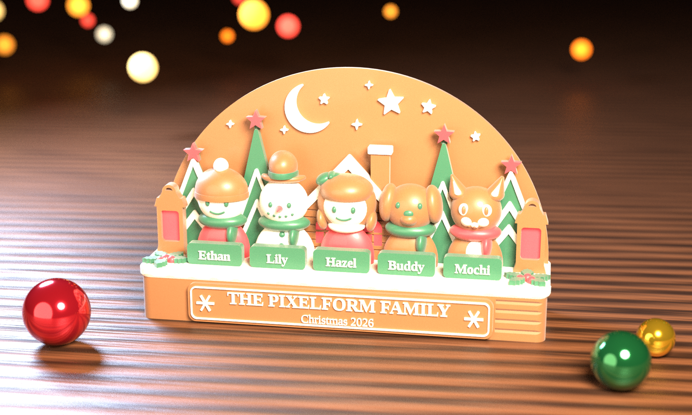
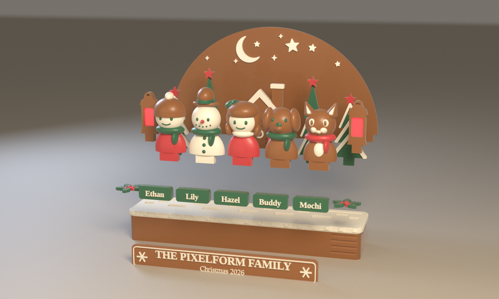

# 4색 에디션 — THE PIXELFORM FAMILY · Christmas 2026

사용자가 보내 주신 `family_ornament_4color.scad`(필라멘트 **4색만** 쓰는 버전: 코코아 갈색 · 아이보리 · 숲 초록 · 크리스마스 빨강)를
**조립 가능한지 전부 검사**하고, 문제를 고치고, **뒤판(밤하늘)의 달과 별을 다시 디자인**했습니다.



| 슬롯 | 색 | HEX | 쓰이는 곳 |
|---|---|---|---|
| 1 | 아이보리 (WHITE) | `#F4EEDD` | 눈, 달·별, 글자, 얼굴, 눈사람 몸, 칼라 |
| 2 | 코코아 갈색 (BROWN) | `#936039` | 하늘 판, 나무 받침, 집 벽, 명판, 랜턴 틀, 모자·머리·털 |
| 3 | 숲 초록 (GREEN) | `#32694C` | 나무, 이름표 판, 목도리, 눈, 리본, 호랑가시 잎 |
| 4 | 빨강 (RED) | `#CA4046` | 별(나무 꼭대기), 재킷·원피스, 집 창문, 랜턴 유리, 열매, 코 |

4색뿐이라 **베드 두 장에 똑같은 4색**을 넣으면 됩니다(AMS 슬롯 1~4를 한 번만 맞추고 두 번 출력).

---

## 1. 조립 가능 상태 점검 결과

`tools/check_fit.py`(조각끼리 겹침) · `tools/check_assembly.py`(끼움 깊이·접촉·위로 빼 보기) · `tools/check_pieces.py`(출력 가능성) 로 완성 상태의 STL 64개를 검사했습니다.
전체 출력은 `docs/ASSEMBLY_REPORT.txt`, `docs/PRINT_REPORT.md`.

**문제 없이 맞던 것 (보내 주신 설계 그대로)**
- 서로 다른 조각끼리 겹침 **0** (0.05 mm³ 기준).
- 나무 4 + 집(2개 키 달린 장부)은 홈에 **6.7 mm** 깊이로 끼워지고, 옆·바닥 여유는 0.2 mm(`tol`)로 맞습니다. 하늘 판·랜턴은 7.0 mm, 인물은 7.2 mm.
- 닫힌 메시 64/64, 조각별 오버행 검사(0.2 mm 레이어, 45°) **0**.
- 가장 얇은 벽은 랜턴 홈과 바깥쪽 나무 홈 사이 약 2.4 mm — 쓸 만합니다.

**찾아서 고친 것**

| # | 문제 | 수정 |
|---|---|---|
| 1 | 소녀 리본이 바로 옆 눈사람과 x 범위가 겹쳐서, 눈사람을 곧게 위로 뽑으려면 소녀가 먼저 빠져야 했음(끼우는 순서가 정해짐) | 리본을 1 mm 오른쪽으로(`girl_bow`). 이제 인물 5명 모두 **어떤 순서로든** 위에서 끼우고 뺄 수 있음 |
| 2 | `layout="print"` 로 STL 을 내보내면 조각이 원점에서 멀리(예: y = −135) 놓여 소수점 반올림 때문에 **소년 눈(`fig0__eyes`)이 닫힌 메시가 아니게 됨** | `layout="local"` 추가(조각을 자기 원점에 내보냄). 슬라이서용 STL·3MF 는 `local` 로 내보냄. 화면용 `print` 배치는 그대로 |
| 3 | 이름표를 위에서 내려놓으면 인물 얼굴(앞으로 ~10 mm 튀어나옴)에 걸림 | 이름표·명판은 **앞에서 밀어 넣어 접착**(검사 통과). 아래 조립 순서에 적음 |
| 4 | 달·별 리본 모티프가 나무 가림막(`tree_blockers`)과 얽혀 별이 잘려 조각이 남을 수 있었음. 또 나무·집이 이제 하늘 판의 별·달 모티프 **앞 2 mm** 에 서 있어서 가림막이 필요 없어짐 | 모티프를 새로 디자인(아래), 리본·가림막 삭제 |

**남은 한계(그대로 둠)**: 슬라이서 자동 서포트 점검(45°)에서 베드 1 은 0, 베드 2 는 고양이 얼굴 부근 약 50 mm 필라멘트(≈ 0.15 g)가 나옵니다 — 위치를 끝까지 특정하지 못했고 영향은 미미합니다.

### 조립 순서
1. 받침(나무 + 눈)은 한 조각.
2. 하늘 판을 뒤쪽 긴 홈에 위에서 끼움.
3. 나무 4 · 집(탭 2개) · 랜턴 2 · 인물 5 를 각자 홈에 **위에서** 끼움 — 순서 상관없음. 헐거우면 순간접착제 한 방울.
4. 이름표 5 · 명판 · 호랑가시 2 는 **접착**(이름표·명판은 앞에서 밀어 넣어 붙임).



---

## 2. 뒤판의 달과 별 — 새 디자인


**설계 원칙**: 앞에서 보면 나무·집·인물·랜턴이 아치의 아래 2/3를 가리므로, 달과 별은 그 위의 **‘왕관’ 하늘**에만 둡니다.
조립한 모델을 앞에서 본 실루엣(나무·집·인물·랜턴)을 계산해 그 바깥에만 배치했고, 검사 도구(`tools/check_sky.py`)가 실제 STL 로 확인했습니다.

- **초승달**(반지름 12.5)을 꼭대기 왼쪽에, 오목한 곳에 **작은 별** 하나.
- **큰 별**(R 7.2)을 꼭대기 오른쪽에 두고, **작은 별 둘**(R 4.2, 3.0)이 아치의 곡선을 따라 오른쪽 아래로 계단처럼 작아지며 이어짐 — 달과 서로 대답하는 대각선.
- 빈틈은 **네 갈래 반짝이** 4개로 가볍게 채움. 별마다 약간씩 다른 각도(−9° ~ +10°).
- 전부 아이보리 잉크를 **갈색 판(3 mm) 위에 2 mm 높이**로 직접 인쇄 — 떨어진 조각도, 붙일 것도 없음. 끝은 둥글게(`soften`) 해서 0.7 mm 보다 얇은 곳이 없음.

검사: 요소 9개(달 1, 별 4, 반짝이 4), 앞 실루엣까지 최소 **5.9 mm**(기준 2.5), 아치 가장자리까지 **5.4 mm**(기준 3.5), 0.6 mm 보다 얇은 부분 0.5 mm².
위치는 `family_ornament_4color.scad` 의 `MOON` / `STARS` / `SPARKLES` 표에서 바꾸고, 바꾼 뒤 `python tools/check_sky.py stl/assembled` 로 다시 확인하세요.
(검증은 기본 5인 구성 기준입니다. 인원이 달라지면 앞 실루엣이 달라지니 `check_sky.py` 를 다시 돌려 주세요.)

---

## 3. 프린트 베드 2장 (256 × 256 mm, 각 4색)

| 베드 | 슬롯 1·2·3·4 | 조각 | 점유율 | 예상 시간* | 필라멘트(g)* |
|---|---|---|---|---|---|
| **1** 풍경·바닥 | White · Brown · Green · Red | 받침, 하늘 판, 명판, 이름표 5, 호랑가시 2 | 55 % | 11 h 54 m | 27 / 102 / 10 / 2 |
| **2** 인물·나무 | White · Brown · Green · Red | 인물 5, 나무 4, 집, 랜턴 2 | 33 % | 9 h 31 m | 29 / 34 / 20 / 13 |

\* PrusaSlicer 2.7 CLI 일반 프로파일(0.2 mm · 벽 3 · 인필 12 % · 프라임 타워 포함) 추정치. 실제 기계에서는 다릅니다. g 에는 색 교환 퍼지가 포함됩니다.
총량(대략): Brown 136 g · White 56 g · Green 30 g · Red 15 g.


`beds/bedN.3mf`(색별 압출기 지정) 와 `beds/bedN/`(베드 좌표에 배치된 조각×색 STL, 파일명 끝이 색)이 있습니다. 출력 설정과 3MF 가 안 열릴 때의 대처는 상위 `README.md` 1장과 같습니다.
프라임 타워 자리는 뒤쪽 오른쪽 45 × 70 mm 입니다(두 베드 모두 모델과 10 mm 이상 떨어져 있음을 슬라이서 결과로 확인).

---

## 4. 확인하지 못한 것
- **실제 출력은 해 보지 않았습니다.** 0.2 mm 끼움 여유, 작은 글자, 4 mm 두께 나무·집 장부의 강도는 프린터마다 다를 수 있습니다(장식용으로는 충분한 단면이지만 세게 건드리면 부러질 수 있어 접착을 권합니다).
- Bambu Studio / OrcaSlicer 에서 3MF 가져오기는 시험하지 못했습니다(PrusaSlicer 2.7 에서만 확인).
- 이 팔레트에서는 **모자·머리·털이 하늘 판·받침과 같은 갈색**이라 대비가 약한 곳이 있습니다(렌더 참고). 색 배정은 `palettes/four_color.json` 에서 바꾸면 베드가 다시 짜입니다.
- 렌더는 Blender 시각화이며 실제 필라멘트 색·광택과는 다릅니다.

## 5. 다시 만들기
```bash
SCAD=openscad/family_ornament_4color.scad PALETTE=palettes/four_color.json \
PIECE_GROUPS=palettes/groups_4color.json OUT=four_color PRINT_LAYOUT=local EXPOSURE=-1.1 tools/build_all.sh
```
(`SKIP_RENDER=1` 렌더 생략, `SKIP_EXPORT=1` STL 재사용.) 보내 주신 원본은 git 기록의 첫 커밋(`Add user-supplied 4-colour variant …`)에 그대로 있어 `git diff` 로 제가 바꾼 곳을 볼 수 있습니다.
