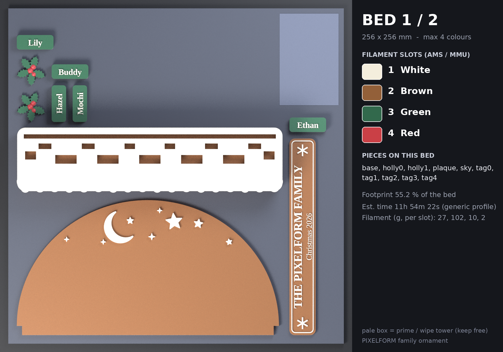
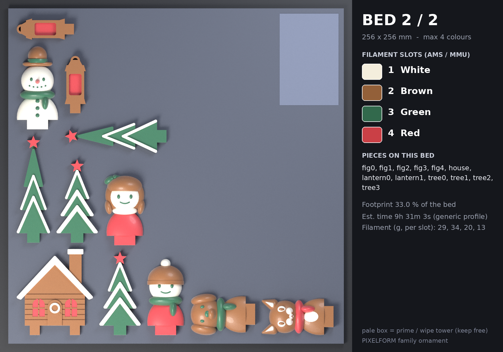

# 프린트 베드 계획 — THE PIXELFORM FAMILY · Christmas 2026

베드 256 × 256 mm, 베드당 최대 4색. 필라멘트 색이 4개를 넘으면 그 색이 필요한 조각은 다음 베드로 넘어갑니다(조각 하나의 모든 색은 항상 같은 베드에서 출력).

| 베드 | 필라멘트 슬롯 1 · 2 · 3 · 4 | 조각 수 | 베드 점유율 | 예상 시간* | 필라멘트(g)* |
|---|---|---|---|---|---|
| **1** | WHITE · BROWN · GREEN · RED | 10 | 55.2 % | 11h 54m 22s | 27 / 102 / 10 / 2 |
| **2** | WHITE · BROWN · GREEN · RED | 12 | 33.0 % | 9h 31m 3s | 29 / 34 / 20 / 13 |

\* PrusaSlicer 2.7 CLI, 0.4 mm 노즐 · 0.2 mm 레이어 · 벽 3 · 인필 12 % · 프라임 타워 포함(`slicer/prusaslicer_4color_256.ini`). 일반적인 느린 프로파일 기준이라 실제 기계(Bambu 등)에서는 달라집니다. 필라멘트 g 은 슬롯 순서이며 색 교환 퍼지(프라임 타워) 분량이 포함됩니다.

## 베드 1

| 슬롯 | 색 | HEX | 순수 모델 부피 |
|---|---|---|---|
| 1 | WHITE (흰색) | `#F4EEDD` | 42.0 cm³ |
| 2 | BROWN (갈색(진저브레드)) | `#936039` | 254.5 cm³ |
| 3 | GREEN (초록) | `#32694C` | 8.7 cm³ |
| 4 | RED (빨강) | `#CA4046` | 0.2 cm³ |

| 조각 | 의미 | 색 구성 |
|---|---|---|
| `base` | 받침(나무 몸통 + 쌓인 눈) | 나무 몸통=BROWN, 쌓인 눈=WHITE |
| `holly0` | 호랑가시 1 | 잎=GREEN, 열매=RED |
| `holly1` | 호랑가시 2 | 잎=GREEN, 열매=RED |
| `plaque` | 명판 THE PIXELFORM FAMILY / Christmas 2026 | 판=BROWN, 글자=WHITE |
| `sky` | 밤하늘 아치 판 | 하늘 판=BROWN, 달·별=WHITE |
| `tag0` | 이름표 Ethan | 판=GREEN, 글자=WHITE |
| `tag1` | 이름표 Lily | 판=GREEN, 글자=WHITE |
| `tag2` | 이름표 Hazel | 판=GREEN, 글자=WHITE |
| `tag3` | 이름표 Buddy | 판=GREEN, 글자=WHITE |
| `tag4` | 이름표 Mochi | 판=GREEN, 글자=WHITE |

- 슬라이서 자동 서포트 점검(45°): 서포트 없음
- 프라임 타워: x 209.8–249.2, y 183.0–247.5 mm (모델과 10.5 mm 이상 떨어짐, 베드 안: 예)
- 색 교환: 슬롯 T0, T1, T2, T3 사용

## 베드 2

| 슬롯 | 색 | HEX | 순수 모델 부피 |
|---|---|---|---|
| 1 | WHITE (흰색) | `#F4EEDD` | 19.4 cm³ |
| 2 | BROWN (갈색(진저브레드)) | `#936039` | 28.9 cm³ |
| 3 | GREEN (초록) | `#32694C` | 15.9 cm³ |
| 4 | RED (빨강) | `#CA4046` | 8.8 cm³ |

| 조각 | 의미 | 색 구성 |
|---|---|---|
| `fig0` | Ethan (boy) | 재킷=RED, 목도리=GREEN, 모자=BROWN, 방울=WHITE, 얼굴=WHITE, 눈동자·표정=GREEN |
| `fig1` | Lily (snowman) | 몸=WHITE, 모자=BROWN, 모자 띠=GREEN, 목도리=GREEN, 코=RED, 눈동자·표정=GREEN |
| `fig2` | Hazel (girl) | 원피스=RED, 칼라=WHITE, 머리=BROWN, 리본=GREEN, 얼굴=WHITE, 눈동자·표정=GREEN |
| `fig3` | Buddy (dog) | 털=BROWN, 귀=BROWN, 목도리=GREEN, 눈동자·표정=GREEN |
| `fig4` | Mochi (cat) | 털=BROWN, 흰 무늬=WHITE, 빨강 무늬=RED |
| `house` | 집 | 벽=BROWN, 쌓인 눈=WHITE, 창문=RED |
| `lantern0` | 랜턴 1 | 틀=BROWN, 유리=RED |
| `lantern1` | 랜턴 2 | 틀=BROWN, 유리=RED |
| `tree0` | 나무 1 | 잎=GREEN, 쌓인 눈=WHITE, 꼭대기 별=RED |
| `tree1` | 나무 2 | 잎=GREEN, 쌓인 눈=WHITE, 꼭대기 별=RED |
| `tree2` | 나무 3 | 잎=GREEN, 쌓인 눈=WHITE, 꼭대기 별=RED |
| `tree3` | 나무 4 | 잎=GREEN, 쌓인 눈=WHITE, 꼭대기 별=RED |

- 슬라이서 자동 서포트 점검(45°): 약 50 mm 필라멘트(≈ 0.15 g) — 사실상 없음
- 프라임 타워: x 209.8–249.2, y 183.0–247.5 mm (모델과 89.9 mm 이상 떨어짐, 베드 안: 예)
- 색 교환: 슬롯 T0, T1, T2, T3 사용

