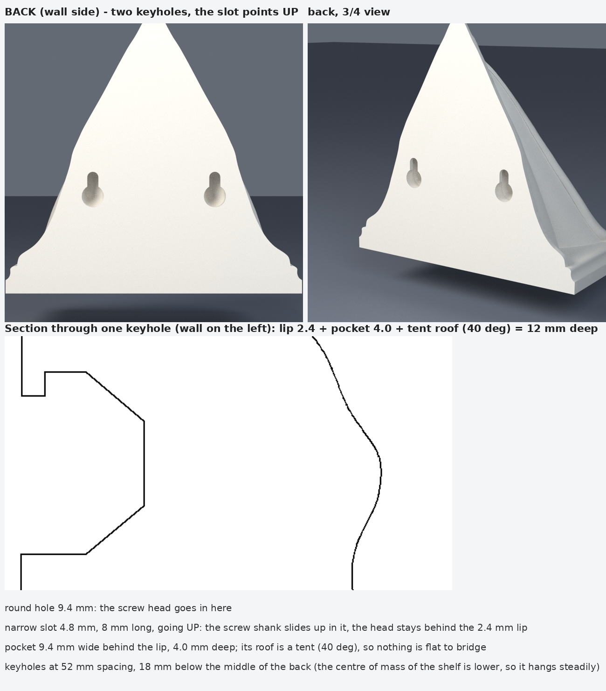

# 👻 Ghostface 코너 선반 — 벽걸이 키홀(열쇠구멍) 추가

올려 주신 `10.21_6.3mf` 는 앞서 만든 피사의 탑이 아니라 **“Meshy_AI_Ghostface_Corner_Shelf”**(Bambu Studio 프로젝트, 삼각형 뒷판 + 마스크 + 받침 선반)였습니다.
이 모델의 **평평한 뒷면(벽에 닿는 면)** 에 벽에 걸 수 있는 **키홀 2개**를 뚫었습니다. 프로젝트의 배치·설정(P1S, 0.2 mm, 뒷면이 베드에 닿는 자세)은 그대로입니다.



| 파일 | 설명 |
|---|---|
| `10.21_6_keyholes.3mf` | Bambu Studio 프로젝트 — 메시만 키홀이 뚫린 것으로 바꿨고 위치·회전·출력 설정은 그대로 |
| `Ghostface_Corner_Shelf_keyholes.stl` | 같은 모델의 STL(뒷면이 아래로 오게 세워져 있음) — 다른 슬라이서용 |
| `tools/add_keyholes.py` | 키홀을 뚫는 스크립트(위치·크기를 바꿔 다시 뚫을 수 있음) |

## 구멍
- **키홀 2개**, 좌우 52 mm 간격(뒷면 가운데에서 ±26 mm), 둥근 구멍의 중심은 뒷판 가운데보다 18 mm 아래. **슬롯은 위쪽**으로 8 mm.
- **둥근 구멍 지름 9.4 mm**: 나사 머리가 들어가는 곳. **좁은 슬롯 4.8 mm**: 나사 몸통이 미끄러져 올라가는 곳. 머리는 그 뒤의 **폭 9.4 mm, 깊이 4.0 mm 주머니**에 걸립니다(입구 쪽 턱 두께 2.4 mm).
- 쓸 수 있는 나사: **머리 지름 ≤ 9 mm, 머리 두께 ≤ 3.6 mm, 몸통 ≤ 4.4 mm**(M4 둥근머리/팬헤드, 석고보드 앵커 나사 #8 등). 나사 머리 아랫면이 벽에서 약 3 mm 떨어지게(머리까지 약 6.5 mm 나오게) 박으세요.
- 거는 법: 두 나사를 52 mm 간격으로 수평하게 박고, 선반을 둥근 구멍에 맞춰 끼운 뒤 **아래로 쓱 내리면** 나사가 슬롯 위쪽에 걸립니다.
- 무게중심이 걸이보다 약 20 mm 아래라서 매달렸을 때 안정적입니다.

## 출력
- **프로젝트의 자세 그대로**(뒷면이 베드에 닿음) 출력하면 키홀은 베드 쪽으로 열립니다. 주머니의 천장을 **40° 텐트(지붕) 모양**으로 만들어서 평평한 천장이 없으므로 **구멍 때문에 서포트가 필요 없습니다.**
- 걸이 부위가 얇은 턱(2.4 mm)이니 **벽(Wall loops)을 3줄 이상**, 인필 15 % 이상을 권장합니다(현재 프로젝트는 벽 2줄·인필 15 %).
- 모델 자체(마스크의 오버행)가 필요로 하는 서포트는 이번 작업과 무관합니다. 프로젝트의 서포트 설정(현재 꺼짐)은 건드리지 않았습니다.

## 확인한 것
- 결과 메시가 **닫혀 있고(watertight) 한 덩어리**, 부피 239.5 → 237.2 cm³(키홀 2개의 부피만큼).
- 실제 메시로 확인: 키홀을 **3 mm 더 크게 키워도** 모델 안쪽에 머무름 → 어디에도 앞면이나 마스크 쪽으로 뚫리지 않고 최소 3 mm 의 재료가 남음. (뒷판 자체는 대부분 1 mm 남짓한 얇은 껍질이라 두꺼운 아래쪽 받침 덩어리 안에 뚫었습니다.)
- 슬라이서(PrusaSlicer, 자동 서포트 45°)로 **키홀 전/후를 같은 조건으로 비교**: 서포트 이동 54,586 → 54,592(변화 거의 없음) — 키홀이 새 서포트를 만들지 않음.
- 3MF XML 이 올바른 구조이고 면 개수 메타데이터(357,458)를 맞춤.

## 확인하지 못한 것
- **Bambu Studio 에서 열어 보지는 못했습니다.** 3MF 의 다른 부분(설정·변환·메타데이터)은 그대로 두고 메시만 바꿨습니다. 썸네일 이미지는 예전 것 그대로입니다. 안 열리면 STL 을 사용하세요.
- 실제 출력과 하중 시험은 하지 않았습니다(PLA, 벽 재질과 앵커에 따라 다름). 무게는 약 100 g 안팎으로 예상하지만 측정하지 않았습니다.

## 다른 위치/크기로 다시 뚫기
```bash
python3 tools/add_keyholes.py --in 원본.3mf --out 결과.3mf --stl 결과.stl --holes="-26,-18;26,-18"   # u(좌우), v(위아래) mm
python3 tools/add_keyholes.py --in 원본.3mf --out 결과.3mf --search                                    # 안전한 자리를 자동으로 찾기
```
필요: Python 3 (`numpy trimesh shapely manifold3d`). `--head --slot --slot-len --lip --pocket --margin` 으로 크기를 바꿉니다.
