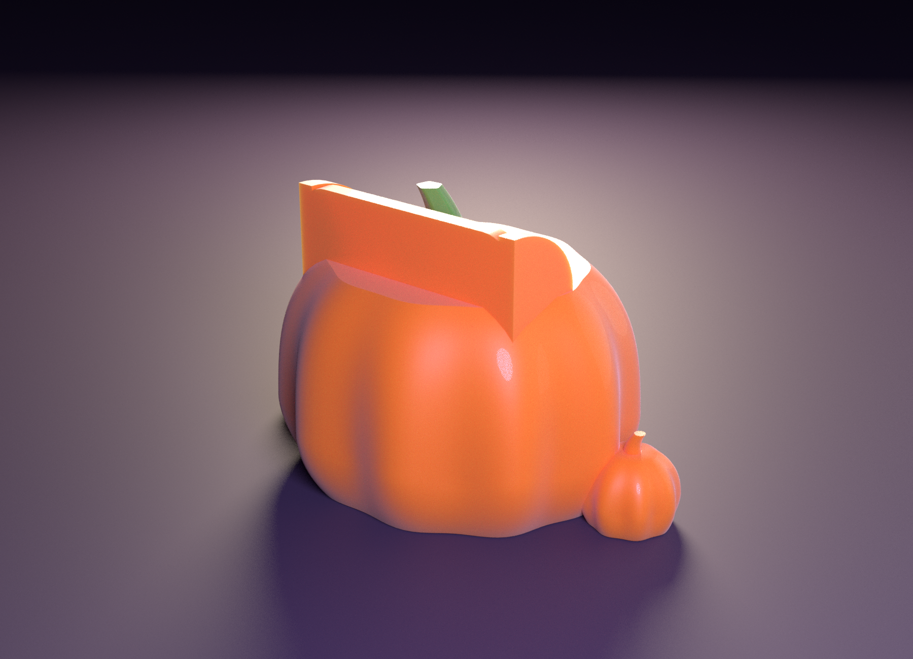

# 🎃 HALLOWEEN PUMPKIN SOUND AMPLIFIER “Smiley” — 웃는 호박 소리 증폭기

보내 주신 **“Fixed Frog Acoustic Horn”(개구리 확성기, `reference/frog_horn_original.scad`) 의 구조**
— *폰 투입구 → 소리 챔버 → 목구멍 → 나팔 → 입* — 를 그대로 가져와, 참고 이미지처럼 **웃는 잭오랜턴**으로 만들었습니다.
전원도 스피커도 없는 **패시브 증폭기**입니다. 폰 아래쪽 스피커의 소리가 호박 속 나팔을 지나 **크게 웃는 입**으로 나옵니다.

**자르지 않은 한 덩어리**입니다. 조립된 모습 그대로, 서 있는 자세로, **서포트 없이** 출력합니다.


| | |
|---|---|
| 크기 | 호박 몸통 폭 약 131 mm, 높이 **75 mm**(윗면) · 폰을 잡는 귀까지 99 mm · 작은 호박까지 폭 **169 mm** · 앞뒤 108 mm · 폰을 꽂으면 바닥에서 약 **181 mm** |
| 구성 | **한 덩어리**: 호박 + 웃는 입 + 눈·코 + 발 2개 + 옆의 작은 호박 2개 + 폰 거치 귀 + 줄기·잎·덩굴 |
| 색 | 주황 + 초록(줄기·잎·덩굴). **한 가지 색으로도 출력 가능**(아래 “출력”) |
| 서포트 | **0** — PrusaSlicer 자동 서포트(45°) 점검 결과 (2색판·1색판 모두) |
| 폰 투입구 | **78 × 14 mm**, 깊이 41 mm + 귀 24 mm (아이폰 13 + 얇은 케이스 기준, 개구리 코드의 `phone_w`·`phone_t`·`slot_d` 그대로) |
| 소리 길 | 챔버(폭 52 mm) → 목구멍(폭 28 mm, 단면 369 mm²) → 나팔(폭 34 mm) → 나팔처럼 벌어지는 웃는 입(앞에서 본 창 폭 80 × 높이 약 40 mm) |
| 프린트 | 베드 1장(256 × 256 mm), 점유율 28 %, **1색 약 10~11 시간 / 2색 약 14 시간** |


---

## 1. 참고 이미지와 같은 점 · 다른 점

| 참고 이미지 | 이 모델 |
|---|---|
| 둥글납작한 호박, 세로 갈비 | ✅ 갈비 10줄, 바닥은 평평 |
| 웃는 큰 입(평평한 위쪽 + 둥근 아래쪽), 안쪽의 혀 같은 바닥 | ✅ 폭 80 mm 의 “D” 모양 입, 바닥이 혀처럼 앞으로 내밀림, 입 안쪽 지붕은 뒤로 갈수록 낮아지는 나팔 모양 |
| 웃는 아치 눈, 작은 삼각 코 | ✅ 아치 눈 2개 + 둥근 삼각 코 (가장자리가 비스듬히 깎인 “카운터싱크” 모양) |
| 줄기 + 큰 잎 + 곱슬 덩굴 | ✅ 줄기(비틀린 갈비무늬), 단풍 모양 잎(잎맥 새김), 곱슬 덩굴 2개 — 덩굴은 납작한 리본(입체로 말리지 않음) |
| 양옆의 작은 호박, 앞쪽 발 | ✅ 옆에 작은 호박 2개(줄기 달림), 입 아래 발 2개 |
| 폰을 잡아 주는 귀 | ✅ 폰 슬롯 양옆의 “귀”와 뒷벽 |
| 입 안쪽이 연한 색 | ❌ 한 가지 색 — 입 안쪽 색을 나누면 레이어마다 색 교환이 생겨 출력이 훨씬 길어집니다 |


---

## 2. 한 덩어리로 서포트 없이 — 입의 설계

웃는 입의 천장을 평평하게 만들면 서 있는 호박에서는 허공 위에 80 mm 를 놓아야 합니다. 처음에는 앞판을 따로 눕혀 뽑는 2조각으로 풀었지만,
**자르지 말아 달라는 요청**에 따라 한 덩어리로 다시 설계했습니다. 핵심은 **입 천장의 기울기 방향**입니다.

* 입 천장을 **뒤쪽(목구멍 쪽)으로 갈수록 낮아지는 경사면**(40°, 확성기 모양)으로 만들었습니다. 앞에서 보면 입 위쪽 선은 여전히 **평평한 D 모양**입니다.
  천장의 가장 낮은 곳이 **단단한 뒷벽**이라 레이어마다 뒷벽에서 앞으로 0.17 mm 씩 자라 나오고, 허공에서 시작하는 선이 없습니다.
* (반대로 “뒤로 갈수록 높아지는” 천장은 입 앞쪽 가장자리의 80 mm 선이 허공에서 시작해 슬라이서가 입 안을 서포트로 채웠습니다 — 약 2.4 m. 이게 처음 시도의 실패였습니다.)
* 확성기처럼 입구가 벌어지는 모양이라 소리를 내기에도 더 낫습니다.

| 서포트를 없애기 위한 설계 | |
|---|---|
| 호박 아랫부분 | 달걀 모양을 가장 넓은 곳(z = 22)보다 22 mm 아래(z = 0)에서 잘라 바닥에서 37° 이하로만 퍼짐, 갈비는 수직 |
| 챔버 | 폰 슬롯의 아래쪽 연장이라 **천장이 없음** |
| 목구멍 | A 자 지붕(38.7°). **앞쪽으로 폭이 서서히 넓어지는 A 자 지붕은 꼭대기 선이 거의 수평이 되어 슬라이서가 서포트를 만들었습니다** → 처음 7 mm 에서 급하게 넓히고(28 → 34 mm) 나머지는 일정한 폭으로 |
| 입 | 바닥은 위를 향하는 둥근 그릇 모양, 옆벽 수직, 천장은 뒤로 낮아지는 40° 경사면 |
| 눈·코 | “카운터싱크” — 구멍이 바닥으로 갈수록 45° 로 작아져 천장이 가파름. 바닥이 호박 표면(갈비 포함)을 따라가도록 각 눈·코의 좌표계를 표면 기울기에 맞춰 돌림 |
| 발 | 돔에 깊이 박힘(중심이 표면보다 안쪽), 아랫부분은 호박과 같은 달걀 모양 |
| 귀 | 수직 벽 + 위쪽이 둥근 곡선 — 윗면이 위를 향함 |
| 줄기 | 한 줄기, 기울기 25° 이하. 잎·덩굴은 평평한 윗면 위에 눕는 얇은 판(1.8~2.7 mm) |



---

## 3. 소리는 어떻게 나가나


1. 폰을 **화면이 입 쪽(앞)을 보게** 투입구에 세워 꽂습니다. 폰의 아래쪽 모서리가 투입구 바닥(z = 34 mm)에 얹히고, 그 바로 아래에 **빈 챔버**가 있습니다.
2. 아이폰 하단의 스피커·마이크가 이 챔버 위에 오도록 챔버를 폭 52 mm 로 넓게 팠습니다. 스피커 소리는 아래로 나와 챔버에 모입니다.
3. 챔버 앞쪽의 **목구멍**(폭 28 mm)에서 **나팔**(34 mm)이 앞으로 이어지다가 입의 뒷벽의 구멍으로 나옵니다. 입은 뒷벽에서 앞으로 갈수록 **위로 벌어지는** 확성기 모양입니다.
4. 입으로 나온 소리가 앞쪽을 향하므로, 호박 앞에 앉은 사람에게 더 잘 들립니다.

개구리 코드와의 대응:

| 개구리 코드 | 이 모델 |
|---|---|
| `phone_w = 78`, `phone_t = 14`, `slot_d = 40` | 같은 이름·값 (`slot_d` 만 41) |
| 폰 슬롯 `cube([phone_w, phone_t, …])` | `slot()` |
| “소리 증폭 챔버” 구(球) | `shaft()` — 천장 없는 직육면체 |
| “폰 ~ 나팔관 목구멍 연결” `hull()` | `horn_body()` — A 자 단면 `hull()` |
| “개구리 입 내부” 원뿔 | `grin()` — 뒤로 낮아지는 지붕이 있는 입 |
| 4개의 다리(킥스탠드) | 없음 — 바닥이 넓고 평평해 폰을 꽂아도 뒤로 넘어가지 않음 |

> **서포트 비교**: 개구리 코드를 `z = 2` 에서 잘린 그대로(회전 없이) OpenSCAD 로 뽑아 같은 PrusaSlicer 프로파일·자동 서포트(45°)로 슬라이스하면
> 서포트와 인터페이스 층에 **약 17.2 m(≈ 51 g, 전체 필라멘트의 26 %)** 가 들어갑니다. 이 호박은 **0** 입니다(다리·튀어나온 눈·기울어진 나팔 때문입니다. 개구리를 일부러 다르게 놓으면 달라질 수 있으니 참고용입니다).

---

## 4. 프린트

| 판 | 필라멘트 | 예상 시간* | 필라멘트* | 서포트 |
|---|---|---|---|---|
| **2색** `beds/bed1.3mf` (주황 + 줄기·잎·덩굴 초록) | 2색 | 14 h 02 m | 주황 207 g + 초록 14 g (프라임 타워 포함) | 없음 |
| **1색** `beds_1color/bed1.3mf` (전부 한 가지 색) | 1색 | 11 h 16 m | 184 g | 없음 |

\* PrusaSlicer 2.7 CLI 일반 프로파일(0.4 mm 노즐 · 0.2 mm 레이어 · 벽 3 · 인필 12 %) 추정치입니다. 실제 기계에서는 달라집니다.
**통덩어리 부피 643 cm³ 라 인필을 줄이면 많이 줄어듭니다**(1색판 기준): 인필 8 % → 약 10 h 09 m / 157 g, 6 % → 약 9 h 36 m / 143 g.

**왜 2색판이 3 시간 더 걸리나**: 줄기(초록, 21 mm)와 폰을 잡는 귀(주황, 24 mm)가 같은 높이 구간에 같이 있어 **그 구간의 모든 레이어마다 색을 바꿔야** 하기 때문입니다(와이프 타워 약 26 m).
시간·필라멘트를 아끼려면 1색판으로 뽑아 줄기·잎·덩굴만 붓으로 칠하세요.


`stl/print/` 의 STL 은 **이미 출력 자세**입니다(서 있는 자세 그대로). `pumpkin__shell.stl` = 주황 부분, `pumpkin__green.stl` = 줄기·잎·덩굴(초록 부분).

### 출력 방법
1. 3MF 를 엽니다. 안 열리면 STL 두 개를 “여러 파트를 가진 하나의 오브젝트”로 불러오세요(위치는 이미 맞춰져 있으니 움직이지 마세요). 1색으로 뽑으려면 두 파트에 같은 필라멘트를 지정하면 됩니다.
2. **회전·뒤집기 금지.**
3. 서포트 **끔**, 레이어 0.2 mm. **벽은 4줄 이상을 권합니다**(챔버·나팔 벽이 두꺼울수록 새지 않고 울림이 덜합니다), 윗면 5층. 인필은 6~10 % 로 충분합니다.
4. 귀(24 mm)는 서 있으니 **바닥 안착을 위해 브림 3~5 mm** 를 권합니다(모델에는 포함하지 않았습니다).
5. 폰 둘레의 틈을 막으세요(“폰에 맞추기” 참고).

---

## 5. 폰에 맞추기 · 내 것으로 바꾸기

`openscad/halloween_horn.scad` 맨 위 (개구리 코드와 같은 세 값):

```
phone_w = 78;   // 투입구 폭   (아이폰 13 = 71.5 mm + 케이스)
phone_t = 14;   // 투입구 두께 (아이폰 13 = 7.65 mm + 케이스, 꼭 맞게)
slot_d  = 41;   // 폰이 호박 속으로 들어가는 깊이
```

- **폰이 투입구보다 얇으면 소리가 샙니다.** 지금 값은 케이스를 낀 아이폰 13 이 들어갈 만큼 넉넉해서 맨몸 폰이면 둘레에 약 **412 mm²** 의 틈이 남습니다(검사 도구 계산). 투입구 둘레에 **스펀지 테이프**를 붙이거나, 맨몸 폰이면 `phone_t = 9.2` 로 줄이세요.
- 다른 폰이면 `phone_w` = 폰 폭 + 2~6 mm, `phone_t` = 폰 두께 + 1.5 mm 를 넣으세요. 폰 하단의 스피커 위치가 다르면 챔버 폭 `SHAFT_W` 도 확인하세요.
  **`slot_d` 를 줄이면(폰이 더 얕게 꽂힘) 목구멍 지붕이 폰 아래 모서리보다 높아져 소리가 폰 앞면 틈으로 샐 수 있습니다** — 목구멍 꼭대기(`HZ0 + HH1 + W_T/2/SLH` ≈ 26.5 mm)가 투입구 바닥(`Z_SF` = 33.7 mm)보다 낮아야 합니다.
- `Rx`·`RYF`·`ZC`·`RZL`·`RZU` — 호박 크기와 모양. **`RZL` 과 `ZC` 는 아래쪽 기울기를 정하므로(37°)** 바꾸면 서포트가 생길 수 있습니다.
- `D_X`·`D_ZT`·`D_RB`·`ROOM`·`RK` — 입의 폭·위쪽 선의 높이·아래 모서리의 둥글기·깊이·천장의 기울기. **`RK` 를 1.0 아래로 낮추거나 `D_ZT` 를 올려 천장이 더 높아지면 서포트가 생길 수 있고**, 목구멍 지붕(꼭대기 약 26 mm)보다 입 뒷벽의 높이(`D_ZT - RK × ROOM` ≈ 32 mm)가 높아야 합니다.
- `EYE_X`·`EYE_Z`·`NOSE_Z` — 눈·코 위치. `FOOT_Y` — 발의 깊이(발이 돔 밖으로 많이 나오면 오버행이 됩니다).
- `LEAF`·`VINES`·`STEM_*` — 잎·덩굴·줄기. 덩굴은 “거북이 그래프”(시작점·방향·곡률)로 그립니다.
- 바꾼 뒤에는 `tools/build_all.sh` 의 검사를 다시 돌리세요(`SKIP_RENDER=1` 렌더 생략, `SKIP_EXPORT=1` STL 재사용, `CHECKS=0`, `SLICE=0`).
  필요: OpenSCAD 2021.01+, Python 3 (`trimesh numpy scipy shapely rtree manifold3d pillow`), Blender 4.x(렌더), PrusaSlicer(슬라이스 점검).
- OpenSCAD 2021.01 로 전체를 내보내는 데 약 35 초.


---

## 6. 확인한 것 / 확인하지 못한 것

**확인함** (`docs/PRINT_REPORT.md`, `docs/AIRPATH_REPORT.txt`, `beds/PLAN.md`, `beds_1color/`)
- STL 2개(주황·초록) 모두 닫힌 메시, 부피 646 cm³(주황 643 + 초록 3.5), **한 덩어리**.
- **레이어 검사(0.2 mm, 45°, 출력 자세): 오버행 0 mm³.**
- **PrusaSlicer 자동 서포트(45°)를 켜고 슬라이스: 서포트 0** (2색판·1색판 모두).
- **공기 길 검사** (`tools/check_airpath.py`, 0.6 mm 복셀): 폰 둘레를 막으면 챔버의 공기는 **입으로만** 나옵니다. 나팔을 판으로 막으면 어디로도 새지 않아 **다른 구멍이 없습니다.**
  단면적: 목구멍 369 → 나팔 470 → 나팔 끝 1,393 → 앞에서 본 입 창 약 6,970 mm².

**설계하며 부딪힌 것 (고친 것)**
- **정렬 핀 + 소켓(2조각 시절)**: 작은 핀·소켓도 슬라이서가 서포트를 만들었습니다. 한 덩어리로 바꾸면서 자연히 사라졌습니다.
- **입 천장의 방향**: 처음에는 천장이 뒤로 갈수록 높아지게 했더니(앞쪽 가장자리가 허공에서 시작) 서포트 약 2.4 m. 뒤로 갈수록 낮아지게 뒤집어 0 이 되었습니다.
- **목구멍의 꼭대기 선**: 앞으로 갈수록 천천히 높아지는 A 자 지붕은 꼭대기 선이 거의 수평이라 슬라이서가 선 아래에 서포트 기둥을 세웠습니다 → 급하게 넓힌 뒤 일정한 폭으로.
- **눈·코 구멍**: 평평한 바닥으로 파면 호박의 곡면 때문에 안쪽은 깊고 바깥쪽은 얕아지고, 표면 앞에 얇은 껍질이 남아 서포트가 생겼습니다 → 표면 기울기에 맞춰 돌린 좌표계 + 표면보다 훨씬 앞에서 시작하는 카운터싱크 구멍으로 0. 그리고 갈비의 높낮이(±1.8 mm)를 반영해 표면 위치를 계산하니 코가 점처럼 작아지던 문제도 해결됐습니다.
- **발**: 중심이 돔 표면 밖에 있으면 눕혀 출력할 때 서포트가 생겼습니다(2조각 시절). 지금은 서서 출력하므로 일반 작은 호박처럼 문제없습니다.

**확인하지 못함 — 읽고 판단하세요**
- **실제로 출력하거나 소리를 재 보지 않았습니다.** “소리가 얼마나 커지는지”(음압, dB)는 **측정하지 않았습니다.** 모양은 개구리 코드와 같은 원리(챔버 + 나팔)로 만들고 공기 길이 이어지는지 확인했을 뿐입니다.
  이런 패시브 증폭기는 보통 **전혀 증폭하지 않고 소리의 방향을 앞으로 모아 주는 정도**이고, 나팔이 폭 28~34 mm 의 짧은 관이라 **저음은 거의 늘지 않습니다.** 큰 소리를 기대하지는 마세요.
- 입은 깊이가 약 12 mm 로 얕고 목구멍에서 입으로 한 번에 넓어지는 모양이라 정통 “호른”의 부드러운 확장은 아닙니다(서포트 0 과 맞바꾼 부분입니다).
- 서포트가 정말 없는지는 PrusaSlicer 자동 서포트(45°)로만 확인했고, 다른 슬라이서·설정에서는 달라질 수 있습니다. 입 천장은 수직에서 약 40° 기울어져 한계(45°)에 가깝습니다. 눈·코 가장자리의 얇은 경사도 0.4 mm 노즐로 깨끗이 나오는지는 실제로 뽑아 봐야 압니다.
- 폰 둘레의 틈(412 mm²)과 케이스 두께는 폰마다 다릅니다. 스펀지 테이프로 막아 보세요.
- 아이폰 13 하단의 스피커·마이크 위치는 일반적인 배치를 가정했습니다(챔버 폭 52 mm 가 둘 다 덮도록).
- 3MF 는 PrusaSlicer 형식이고 PrusaSlicer 2.7 에서만 열어 확인했습니다. **Bambu Studio / OrcaSlicer 가져오기는 시험하지 못했습니다**(위 STL 방법 사용).
- 시간·필라멘트 수치는 일반 프로파일 추정치입니다.
- 렌더는 Blender 시각화입니다(PLA 색·빛 투과는 필라멘트에 따라 다릅니다). 폰은 단순한 막대 모형이고 화면 그림은 설명용이며, 소리 화살표도 설명용 그림입니다.

---

## 7. 폴더

```
openscad/halloween_horn.scad    파라메트릭 모델 (part = pumpkin | all | phone | manifest)
reference/frog_horn_original.scad   보내 주신 개구리 코드 (비교용 사본)
stl/print/                      pumpkin__shell.stl(주황) · pumpkin__green.stl(초록) + manifest/config  (서 있는 출력 자세)
stl/assembled/                  같은 STL (공기 길 검사·렌더용)
beds/                           bed1.3mf (2색), bed1/, PLAN.md, plan.json, slice_summary.json
beds_1color/                    bed1.3mf (한 가지 색), bed1/, slice_summary.json
renders/                        hero · night · face · side · section · top · bed1
docs/                           PRINT_REPORT.md, AIRPATH_REPORT.txt
palettes/                       groups.json (베드 묶음), one_color.json (1색판)
slicer/prusaslicer_4color_256.ini   256 × 256 점검용 최소 프로파일
tools/                          export_roles · plan_beds · check_pieces · check_airpath · slice_check · render_scene · compose_beds · write_plan_md · build_all.sh
blender/render_showcase.py      Cycles 렌더러(headless)
```
