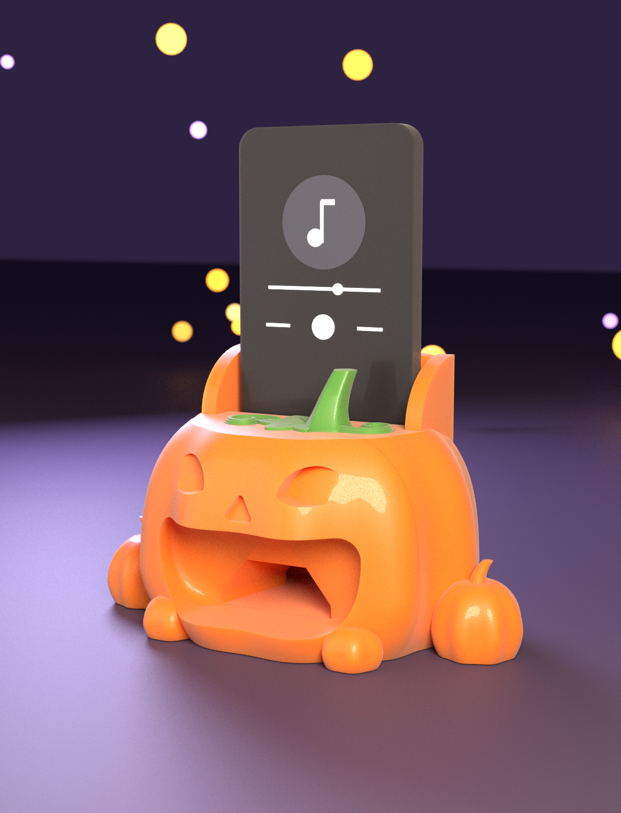
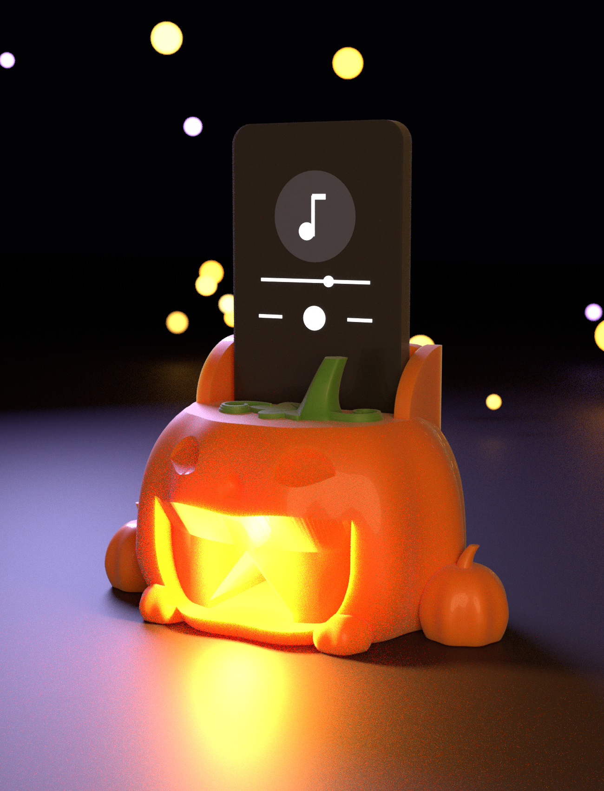
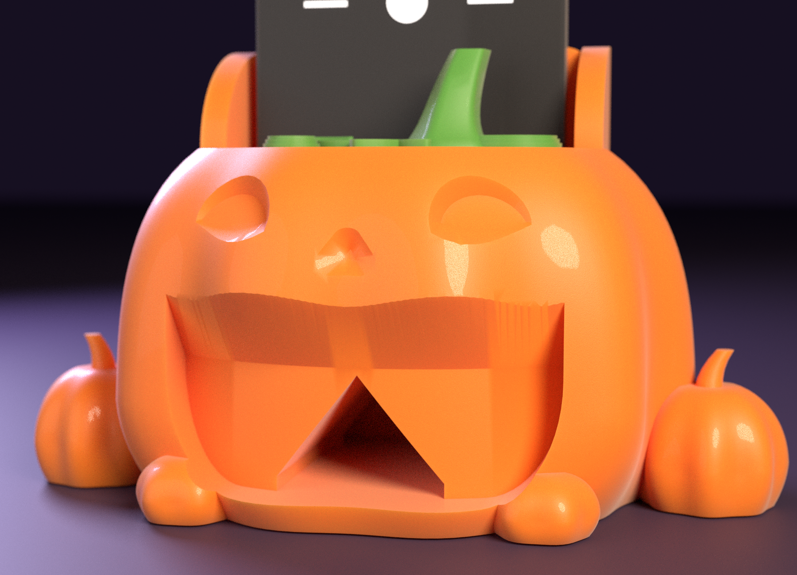
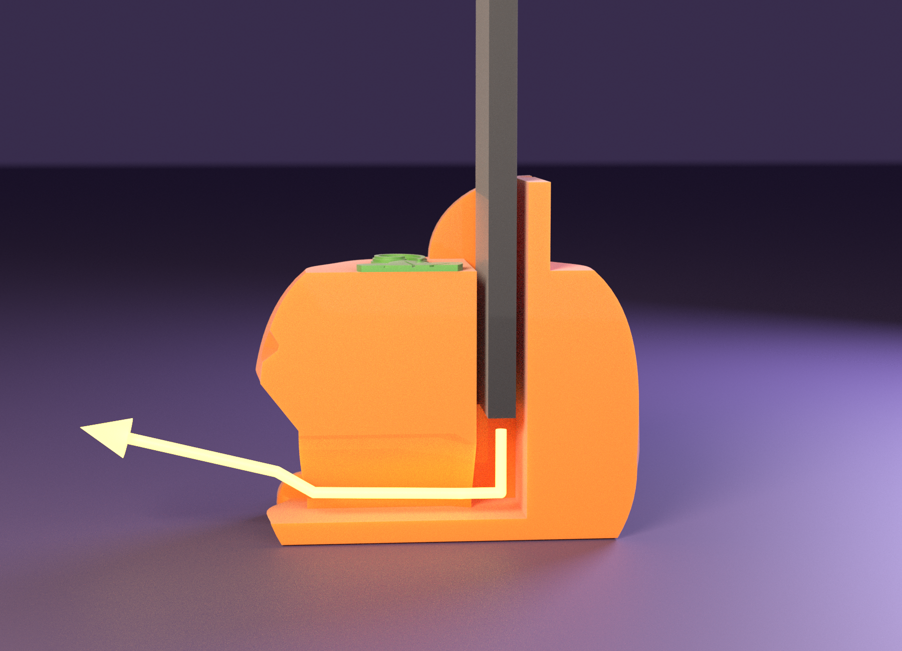
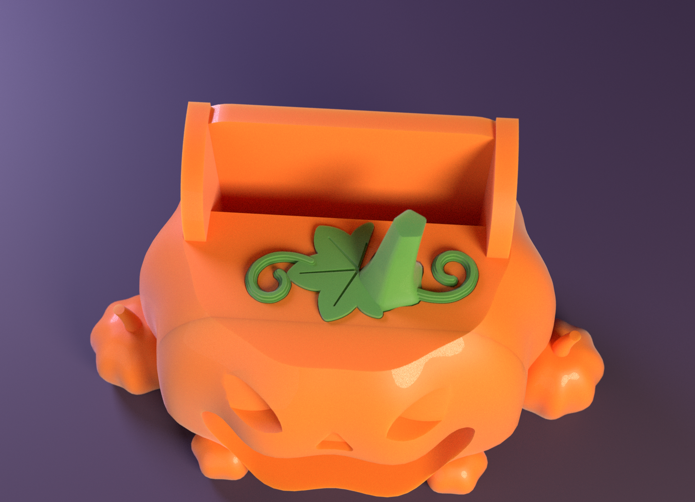

# 🎃 HALLOWEEN PUMPKIN SOUND AMPLIFIER “Smiley” — 웃는 호박 소리 증폭기

보내 주신 **“Fixed Frog Acoustic Horn”(개구리 확성기, `reference/frog_horn_original.scad`) 의 구조**
— *폰 투입구 → 소리 챔버 → 목구멍 → 나팔 → 입* — 를 그대로 가져와, 참고 이미지처럼 **웃는 잭오랜턴**으로 만들었습니다.
전원도 스피커도 없는 **패시브 증폭기**입니다. 폰 아래쪽 스피커의 소리가 호박 속 나팔을 지나 **크게 웃는 입**으로 나옵니다.



| | |
|---|---|
| 크기 | 호박 몸통 약 **131 × 109 mm**(가장 넓은 곳), 높이 **75 mm**(윗면) · 폰을 잡는 귀까지 99 mm · 옆의 작은 호박까지 폭 **169 mm** · 폰을 꽂으면 바닥에서 약 **181 mm** |
| 조각 | **3개** — ① 본체(폰 슬롯·챔버·귀·작은 호박) ② 얼굴 앞판(눈·코·입·발) ③ 줄기·잎·덩굴(납작한 한 조각) |
| 색 | **2색** — 주황 호박 + 초록 줄기·잎·덩굴. **한 번의 출력에는 색이 하나뿐**이라 색 교환·프라임 타워가 없습니다 |
| 프린트 | **베드 2장**(256 × 256 mm): 베드 1 = 본체 + 앞판(주황, 약 11~12 시간) · 베드 2 = 줄기·잎·덩굴(초록, 약 30 분) |
| 서포트 | **0** — PrusaSlicer 자동 서포트(45°) 점검 결과, 두 베드 모두 |
| 폰 투입구 | **78 × 14 mm**, 깊이 41 mm + 귀 24 mm (아이폰 13 + 얇은 케이스 기준, 개구리 코드의 `phone_w`·`phone_t`·`slot_d` 그대로) |
| 소리 길 | 챔버(폭 52 mm) → 목구멍(폭 28 mm, 단면 396 mm²) → 나팔(폭 44 mm 까지) → 웃는 입(폭 80 mm, 단면 2,448 mm²). 공기 단면적은 **6.2 : 1** 로 넓어짐 |



---

## 1. 참고 이미지와 같은 점 · 다른 점

| 참고 이미지 | 이 모델 |
|---|---|
| 둥글납작한 호박, 세로 갈비 | ✅ 갈비 10줄, 바닥은 평평 |
| 웃는 큰 입(평평한 위쪽 + 둥근 아래쪽), 안쪽의 혀 같은 바닥 | ✅ 폭 80 × 높이 34 mm 의 “D” 모양 입, 입 안쪽으로 부드럽게 좁아지는 깔때기, 바닥은 혀처럼 앞으로 내밀림 |
| 웃는 아치 눈, 작은 삼각 코 | ✅ 아치 눈(폭 20 mm) 2개 + 둥근 삼각 코, 깊이 4.5 mm 로 새김 |
| 줄기 + 큰 잎 + 곱슬 덩굴 | ✅ 줄기(비틀린 갈비무늬), 단풍 모양 잎(잎맥 새김), 곱슬 덩굴 2개 — 덩굴은 납작한 리본(입체로 말리지 않음) |
| 양옆의 작은 호박, 앞쪽 발 | ✅ 옆에 작은 호박 2개(줄기 달림), 입 아래 발 2개 |
| 폰을 잡아 주는 귀 | ✅ 폰 슬롯 양옆의 “귀”와 뒷벽 |
| 입 안쪽이 연한 색 | ❌ 한 가지 색(주황) — 입 안쪽 색을 나누면 레이어마다 색 교환이 생겨 출력이 훨씬 길어집니다 |



---

## 2. 왜 2조각인가 — 웃는 입과 “서포트 0” 을 함께 얻는 방법

웃는 입의 천장은 평평합니다. 서 있는 호박에 폭 80 mm 의 평평한 천장을 만들면 서포트가 필요합니다.
그래서 호박을 **입 뒤쪽 평면(y = 26 mm)에서 둘로 나눕니다.**

* **얼굴 앞판**은 **얼굴이 위로 오게 눕혀서** 출력합니다. 베드에 닿는 면이 자른 면이라 평평하고, 돔 모양의 앞면은 올라갈수록 줄어듭니다.
  입·눈·코는 “위로 갈수록 넓어지는 구멍”일 뿐이라 **어떤 모양이든(평평한 천장, 둥근 아치 눈) 오버행이 생기지 않습니다.**
* **본체**는 서서 출력합니다. 목구멍은 뾰족 지붕(38.7°)의 A 자 단면이라 서포트가 필요 없습니다.
* **줄기·잎·덩굴**은 납작한 한 조각이라 따로 출력해 본체 윗면의 **0.8 mm 얕은 홈**에 접착합니다. 이렇게 하면 베드 1 이 단색이 됩니다
  (처음에는 줄기를 본체에 붙여 2색으로 뽑으려 했는데, 위쪽 24 mm 구간에서 주황 귀와 초록 줄기가 같은 레이어에 있어 **레이어마다 색을 바꾸게 되어** 슬라이서 추정이 15.5 시간 / 와이프 타워 26 m 로 늘었습니다 → 분리해서 12.5 시간으로).

| 서포트를 없애기 위한 설계 | |
|---|---|
| 호박 아랫부분 | 달걀 모양을 가장 넓은 곳(z = 22)보다 22 mm 아래(z = 0)에서 잘라 바닥에서 36~38° 이하로만 퍼짐 |
| 목구멍(본체) | A 자 지붕 38.7° — 넓어질수록 지붕은 더 가팔라지고 평평해지지 않음 |
| 챔버 | 폰 슬롯의 아래쪽 연장이라 **천장이 없음** |
| 입·눈·코(앞판) | 눕혀 출력하므로 “위로 넓어지는 구멍” — 오버행 없음. 입 안쪽 깔때기는 목구멍에서 입 모양으로 섞여 넓어짐 |
| 발 | 돔에 깊이 박아(중심이 표면보다 약 1.4 mm 안쪽) 뒤쪽이 허공에 뜨지 않게. (처음에는 중심이 표면 밖 2.6 mm 였더니 슬라이서가 서포트를 만들었습니다) |
| 귀 | 수직 벽 + 위쪽이 둥근 곡선 — 윗면이 위를 향함 |
| 잎·덩굴 | 평평한 판 위에 얹힘(1.8~2.7 mm 두께) |
| 정렬용 핀·홈 | **일부러 넣지 않음** — 아주 작은 핀·홈도 슬라이서가 서포트를 만들었습니다(아래 “설계하며 부딪힌 것”) |


---

## 3. 소리는 어떻게 나가나



1. 폰을 **화면이 입 쪽(앞)을 보게** 투입구에 세워 꽂습니다. 폰의 아래쪽 모서리가 투입구 바닥(z = 34 mm)에 얹히고, 그 바로 아래에 **빈 챔버**가 있습니다.
2. 아이폰 하단의 스피커·마이크가 이 챔버 위에 오도록 챔버를 폭 52 mm 로 넓게 팠습니다. 스피커 소리는 아래로 나와 챔버에 모입니다.
3. 챔버 앞쪽의 **목구멍**(폭 28 mm)에서 나팔이 앞으로 갈수록 44 mm 폭까지 벌어지고, 접합면을 지나 **깔때기**로 웃는 입(폭 80 mm)까지 넓어집니다.
4. 입으로 나온 소리가 앞쪽을 향하므로, 호박 앞에 앉은 사람에게 더 잘 들립니다.

개구리 코드와의 대응:

| 개구리 코드 | 이 모델 |
|---|---|
| `phone_w = 78`, `phone_t = 14`, `slot_d = 40` | 같은 이름·값 (`slot_d` 만 41) |
| 폰 슬롯 `cube([phone_w, phone_t, …])` | `slot()` |
| “소리 증폭 챔버” 구(球) | `shaft()` — 천장 없는 직육면체 |
| “폰 ~ 나팔관 목구멍 연결” `hull()` | `horn_body()` — A 자 단면 `hull()` |
| “개구리 입 내부” 원뿔 | 본체의 나팔 + 앞판의 `funnel()` + 웃는 입 |
| 4개의 다리(킥스탠드) | 없음 — 바닥이 넓고 평평해 폰을 꽂아도 뒤로 넘어가지 않음 |

> **서포트 비교**: 개구리 코드를 `z = 2` 에서 잘린 그대로(회전 없이) OpenSCAD 로 뽑아 같은 PrusaSlicer 프로파일·자동 서포트(45°)로 슬라이스하면
> 서포트와 인터페이스 층에 **약 17.2 m(≈ 51 g, 전체 필라멘트의 26 %)** 가 들어갑니다. 이 호박은 **0** 입니다(다리·튀어나온 눈·기울어진 나팔 때문입니다. 개구리를 일부러 다르게 놓으면 달라질 수 있으니 참고용입니다).

---

## 4. 프린트

| 베드 | 조각 | 색 | 점유율 | 예상 시간* | 필라멘트* | 서포트 |
|---|---|---|---|---|---|---|
| **1** | 본체 + 얼굴 앞판 | 주황 | 34 % | 12 h 29 m (인필 12 %) | 192 g | 없음 |
| **2** | 줄기·잎·덩굴 | 초록 | 3 % | 28 m | 3 g | 없음 |

\* PrusaSlicer 2.7 CLI 일반 프로파일(0.4 mm 노즐 · 0.2 mm 레이어 · 벽 3 · 인필 12 %) 추정치입니다. 실제 기계에서는 달라집니다.
**본체가 부피 535 cm³ 의 통덩어리라 인필을 줄이면 많이 줄어듭니다**: 인필 8 % → 약 11 h 17 m / 166 g, 6 % → 약 10 h 48 m / 153 g (같은 추정).


`beds/bed1.3mf`·`beds/bed2.3mf`(색별 압출기 지정)와 `beds/bedN/`(베드 좌표에 배치된 STL)이 있습니다.
`stl/print/` 의 STL 은 **이미 출력 자세**입니다(앞판은 눕혀져 있음).

### 출력 방법
1. 3MF 를 엽니다. 안 열리면 `beds/bed1/` 의 STL 두 개를 “여러 파트를 가진 하나의 오브젝트”로 불러오세요(위치는 이미 맞춰져 있으니 움직이지 마세요). 베드 2 도 같습니다.
2. **조각을 회전·뒤집지 마세요.** 본체는 서서, 앞판은 얼굴이 위로 오게 눕혀서, 줄기·잎·덩굴은 납작하게.
3. 서포트 **끔**, 레이어 0.2 mm. **벽은 4줄 이상을 권합니다**(챔버·나팔 벽이 두꺼울수록 새지 않고 울림이 덜합니다), 윗면 5층. 인필은 6~10 % 로 충분합니다.
4. 앞판은 낮고(28 mm) 면이 넓어 붙임이 좋습니다. 본체의 귀(24 mm)는 서 있으니 **바닥 안착을 위해 브림 3~5 mm** 를 권합니다(모델에는 포함하지 않았습니다).

---

## 5. 조립

1. **덩굴·잎·줄기를 본체 윗면에 접착.** 윗면의 얕은 홈(0.8 mm, 잎·줄기·덩굴 모양)에 맞춰 넣고 순간접착제(젤 타입)를 바릅니다.
2. **앞판을 본체에 접착.** 본체의 평평한 앞면(y = 26 mm)에 앞판의 평평한 뒷면을 붙입니다. **정렬은 입 안쪽에서 보이는 목구멍 구멍(A 자 모양)과 바깥 윤곽을 맞춰** 하세요.
   소리가 새지 않도록 **목구멍 구멍 둘레에 접착제를 끊김 없이 한 바퀴** 바르고(에폭시 또는 젤 순간접착제), 테이프로 고정해 굳힙니다.
   (접합선은 호박 옆면에 보입니다 — 퍼티로 메우고 갈거나, 칠하면 숨겨집니다.)
3. **폰 둘레의 틈을 막기.** 지금 값은 케이스를 낀 아이폰 13 이 들어갈 만큼 넉넉해서 맨몸 폰이면 둘레에 약 **412 mm²** 의 틈이 남습니다(검사 도구 계산). 투입구 둘레에 **스펀지 테이프**를 붙이거나, 맨몸 폰이면 `phone_t = 9.2` 로 줄이세요.
4. 폰을 **화면이 입 쪽을 보게** 꽂습니다.

---

## 6. 폰에 맞추기 · 내 것으로 바꾸기

`openscad/halloween_horn.scad` 맨 위 (개구리 코드와 같은 세 값):

```
phone_w = 78;   // 투입구 폭   (아이폰 13 = 71.5 mm + 케이스)
phone_t = 14;   // 투입구 두께 (아이폰 13 = 7.65 mm + 케이스, 꼭 맞게)
slot_d  = 41;   // 폰이 호박 속으로 들어가는 깊이
```

- 다른 폰이면 `phone_w` = 폰 폭 + 2~6 mm, `phone_t` = 폰 두께 + 1.5 mm 를 넣으세요. 폰 하단의 스피커 위치가 다르면 챔버 폭 `SHAFT_W` 도 확인하세요.
  **`slot_d` 를 줄이면(폰이 더 얕게 꽂힘) 목구멍 지붕이 폰 아래 모서리보다 높아져 소리가 폰 앞면 틈으로 샐 수 있습니다** — 목구멍의 꼭대기(`HZ0 + HH1 + W_T/2/SLH` ≈ 32.5 mm)가 투입구 바닥(`Z_SF` = 33.7 mm)보다 낮아야 합니다.
- `Rx`·`RYF`·`ZC`·`RZL`·`RZU` — 호박 크기와 모양. **`RZL` 과 `ZC` 는 아래쪽 기울기를 정하므로(37°)** 바꾸면 서포트가 생길 수 있습니다.
- `D_X`·`D_ZT`·`D_RB` — 웃는 입의 폭·높이·아래 모서리의 둥글기. `EYE_X`·`EYE_Z`·`NOSE_Z` — 눈·코 위치.
- `FOOT_Y` — 발의 깊이. **바꾸면 서포트가 생길 수 있습니다**(발이 돔 밖으로 많이 나오면 그렇게 됩니다).
- `LEAF`·`VINES`·`STEM_*` — 잎·덩굴·줄기. 덩굴은 “거북이 그래프”(시작점·방향·곡률)로 그립니다.
- 바꾼 뒤에는 `tools/build_all.sh` 의 검사를 다시 돌리세요(`SKIP_RENDER=1` 렌더 생략, `SKIP_EXPORT=1` STL 재사용, `CHECKS=0`, `SLICE=0`).
  필요: OpenSCAD 2021.01+, Python 3 (`trimesh numpy scipy shapely rtree manifold3d pillow`), Blender 4.x(렌더), PrusaSlicer(슬라이스 점검).
- OpenSCAD 로 조각 하나씩 내보내는 데 10~15 초(제 환경 OpenSCAD 2021.01).



---

## 7. 확인한 것 / 확인하지 못한 것

**확인함** (`docs/PRINT_REPORT.md`, `docs/AIRPATH_REPORT.txt`, `beds/PLAN.md`)
- STL 3개 모두 닫힌 메시, 부피 본체 535 cm³ · 앞판 86 cm³ · 줄기류 3.5 cm³, 각 조각이 **한 덩어리**.
- **조각별 레이어 검사(0.2 mm, 45°, 출력 자세): 오버행 0 mm³** (세 조각 모두).
- **PrusaSlicer 자동 서포트(45°)를 켜고 두 베드를 슬라이스: 서포트 0.**
- **공기 길 검사** (`tools/check_airpath.py`, 0.6 mm 복셀, 두 조각을 이상적으로 붙인 상태): 폰 둘레를 막으면 챔버의 공기는 **입으로만** 나옵니다. 입을 판으로 막으면 어디로도 새지 않아 **다른 구멍이 없고, 접합면을 가로지르는 길도 이어집니다.**
  단면적: 목구멍 396 → 나팔 569 → 742 → 깔때기 1,715 → 입 2,448 mm²(6.2 : 1).

**설계하며 부딪힌 것 (고친 것)**
- **정렬 핀 + 소켓**: 앞판과 본체를 맞추는 작은 물방울 모양 핀 4개와 소켓을 넣었더니 슬라이서가 핀 아래에 **바닥부터 닿는 서포트 탑**을, 소켓 안에도 작은 서포트를 만들었습니다(약 5 g). 가로로 튀어나온 핀과 위가 막힌 소켓은 아주 작아도 서포트를 부릅니다 → **핀·소켓을 모두 없애고 평평한 접합면 + 접착으로** 바꿨습니다.
- **발**: 반쯤 튀어나오게 붙였더니(중심이 돔 표면 밖) 뒤쪽이 허공에 떠서 서포트가 생겼습니다 → 돔 안쪽으로 깊이 묻었습니다(중심이 표면 밖 2.6 mm → 안쪽 1.4 mm, 반지름 10.5 mm).
- **잎 모양**: 처음의 뾰족한 손가락 모양 잎은 **다른 식물 잎처럼 보였습니다** → 둥근 다섯 갈래의 넓은 단풍·호박잎 모양으로 바꿨습니다.
- **줄기 색**: 줄기를 본체에 붙여 2색으로 뽑았더니 색 교환이 폭증해 15.5 시간이 걸렸습니다 → 줄기·잎·덩굴을 따로 출력.
- 덩굴이 접합면(y = 26 mm)을 넘으면 앞판 윗면 위에 떠서 오버행이 되므로(레이어 검사가 잡아냈습니다) 덩굴·잎을 모두 본체 쪽(y < 25.5 mm)에 두었습니다.
- 공기 길 검사는 처음에 폰 틈 위쪽 공기와 귀 사이 공기를 단면적에 더해 “1,700 mm²” 로 잘못 나왔습니다 → 호박 윗면 아래만 세도록 고쳤습니다.

**확인하지 못함 — 읽고 판단하세요**
- **실제로 출력하거나 소리를 재 보지 않았습니다.** “소리가 얼마나 커지는지”(음압, dB)는 **측정하지 않았습니다.** 모양은 개구리 코드와 같은 원리(챔버 + 나팔)로 만들고 공기 길이 이어지는지 확인했을 뿐입니다.
  이런 패시브 증폭기는 보통 **전혀 증폭하지 않고 소리의 방향을 앞으로 모아 주는 정도**이고, 나팔이 짧고 입 가까이에서 단면이 한 번에 넓어져 **저음은 거의 늘지 않습니다.** 큰 소리를 기대하지는 마세요.
- **접합면의 밀봉은 시험하지 못했습니다.** 위의 공기 길 검사는 접합이 완벽하다고 가정한 시뮬레이션입니다. 접착제를 구멍 둘레에 빈틈없이 바르지 않으면 소리가 접합선으로 샙니다.
- 폰 둘레의 틈(412 mm²)과 케이스 두께는 폰마다 다릅니다. 스펀지 테이프로 막아 보세요.
- 아이폰 13 하단의 스피커·마이크 위치는 일반적인 배치를 가정했습니다(챔버 폭 52 mm 가 둘 다 덮도록).
- 3MF 는 PrusaSlicer 형식이고 PrusaSlicer 2.7 에서만 열어 확인했습니다. **Bambu Studio / OrcaSlicer 가져오기는 시험하지 못했습니다**(위 STL 방법 사용).
- 시간·필라멘트 수치는 일반 프로파일 추정치입니다. 서포트가 정말 없는지는 PrusaSlicer 자동 서포트(45°)로만 확인했고, 다른 슬라이서·설정에서는 달라질 수 있습니다.
- 앞판 돔의 아주 얇은 입 가장자리(입꼬리 쪽 벽 6 mm 이상, 앞쪽 끝은 칼날처럼 가늘어짐)가 0.4 mm 노즐로 깨끗이 나오는지는 실제로 뽑아 봐야 압니다.
- 렌더는 Blender 시각화입니다(PLA 색·빛 투과는 필라멘트에 따라 다릅니다). 폰은 단순한 막대 모형이고 화면 그림은 설명용이며, 소리 화살표도 설명용 그림입니다.

---

## 8. 폴더

```
openscad/halloween_horn.scad    파라메트릭 모델 (part = body | face | garnish | all | phone | manifest, layout = assembled | local)
reference/frog_horn_original.scad   보내 주신 개구리 코드 (비교용 사본)
stl/print/                      body__shell · face__shell · garnish__green — 출력 자세 + manifest/config
stl/assembled/                  같은 STL, 완성품 좌표 (공기 길 검사·렌더용)
beds/                           bed1~2.3mf, bedN/ (베드 좌표에 배치된 STL), PLAN.md, plan.json, slice_summary.json
renders/                        hero · night · face · parts · section · top · bed1~2
docs/                           PRINT_REPORT.md, AIRPATH_REPORT.txt
palettes/groups.json            어떤 조각을 어느 베드에 올릴지 (베드 1 = 본체 + 앞판, 베드 2 = 줄기류)
slicer/prusaslicer_4color_256.ini   256 × 256 점검용 최소 프로파일
tools/                          export_roles · plan_beds · check_pieces · check_airpath · slice_check · render_scene · compose_beds · write_plan_md · build_all.sh
blender/render_showcase.py      Cycles 렌더러(headless)
```
