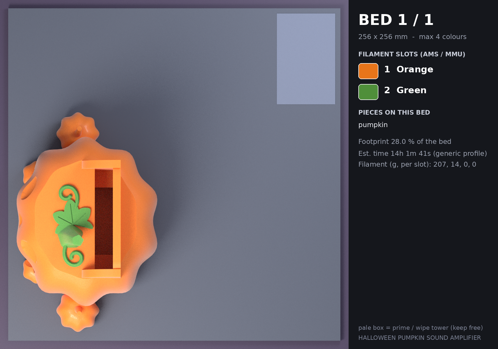

# 프린트 베드 계획 — HALLOWEEN PUMPKIN SOUND AMPLIFIER

베드 256 × 256 mm, 베드당 최대 4색. 조각 하나의 모든 색은 같은 베드에서 출력됩니다.

| 베드 | 필라멘트 슬롯 | 조각 | 베드 점유율 | 예상 시간* | 필라멘트(g)* | 서포트 |
|---|---|---|---|---|---|---|
| **1** | ORANGE · GREEN | 1 | 28.0 % | 14h 1m 41s | 207 / 14 | 없음 |

\* PrusaSlicer 2.7 CLI, 0.4 mm 노즐 · 0.2 mm 레이어 · 벽 3 · 인필 12 %(`slicer/prusaslicer_4color_256.ini`). 일반 프로파일 추정치라 실제 기계에서는 달라집니다. 베드마다 색이 하나뿐이라 색 교환·프라임 타워가 없습니다.

## 베드 1

| 슬롯 | 색 | HEX | 순수 모델 부피 |
|---|---|---|---|
| 1 | ORANGE (주황) | `#E8751A` | 642.5 cm³ |
| 2 | GREEN (초록) | `#4F8F3A` | 3.5 cm³ |

| 조각 | 의미 | 색 구성 |
|---|---|---|
| `pumpkin` | pumpkin | 호박(주황)=ORANGE, 초록=GREEN |

- 슬라이서 자동 서포트 점검(45°): **서포트 없음**
- 프라임 타워: x 209.5–249.5, y 182.0–204.0 mm (모델과 94.8 mm 이상 떨어짐, 베드 안: 예)

