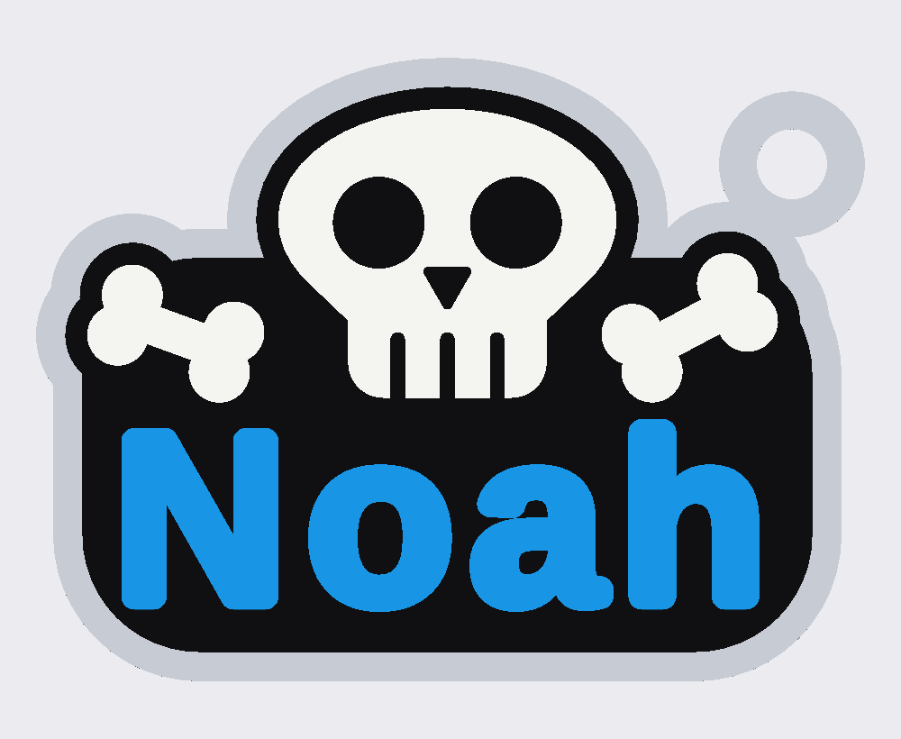

# 04 · Halloween Skull Keyring — 해골 + 뼈 + 이름 키링 (4색)

사진의 특징(하얀 해골의 눈구멍·코·이빨 틈, 양옆의 뼈 2개, 굵은 파란 이름, 검정 판과 검정 윤곽, 연회색 테두리, 오른쪽 위 고리)을 살려
**도형으로 새로 설계**한 키링입니다. 크기 **약 57 × 43 × 3.6 mm**. 색은 정확히 **4가지(AMS 1대)**.

## 파일
| 파일 | 색 | 들어 있는 것 |
|---|---|---|
| `scad/keyring_skull_4color.scad` | — | **OpenSCAD 원본**(색 지정 포함, 이름·크기 수정 가능) |
| `1_gray.stl` | 연회색 | 테두리, 고리 |
| `2_black.stl` | 검정 | 판, 해골·뼈 둘레의 검정 윤곽 |
| `3_white.stl` | 흰색 | 해골, 뼈 2개 |
| `4_blue.stl` | 파랑 | 이름 |
| `onecolor_no_AMS.stl` | 한 색 | 전부 합친 단색 버전(AMS 없을 때, 칠해서 완성) |

4개 부품은 **같은 좌표**라 함께 불러오면 제자리에 맞춰집니다.

## Bambu Studio에서 출력 (AMS)
1. STL 4개를 **한꺼번에 선택**해서 끌어다 놓습니다.
2. "여러 부품을 하나의 객체로 불러오시겠습니까?" → **예**.
3. 부품마다 필라멘트 지정: 1번 연회색, 2번 검정, 3번 흰색, 4번 파랑.
4. 레이어 0.2mm, 서포트 끄기 → 슬라이스 → 출력.

## OpenSCAD에서 직접 (원본 파일)
- `part = "all"` → 4색 미리보기(F5)
- `part = "gray"` / `"black"` / `"white"` / `"blue"` → F6 → STL로 내보내기(색마다 한 번씩)
- `part = "onecolor"` → 단색 STL
- 맨 위 `name_text = "Noah";` 에서 **이름 변경**. 글자 크기는 판 안에 자동으로 맞춰지고, 해골 턱에 닿지 않게 높이도 제한됩니다.
- 한글 이름: `font_name = "Malgun Gothic:style=Bold";` (Windows)
- 크기: `model_scale`(1.0 → 약 57mm). 높이(층)는 줄어들지 않게 x·y만 조절합니다.

## 구조 (층, 모두 0.2mm 배수)
회색 테두리 0~1.6mm → 검정 1.6~2.8mm → 흰색·파랑 2.8~3.6mm. 고리는 회색이 2.8mm까지 올라가 튼튼합니다. 고리 구멍 4.8mm.
눈구멍·코·이빨 틈은 흰색을 뚫어서 아래 검정 판이 보이게 만든 것입니다(오목하게 어두운 눈).

## 검증 현황
**검증됨(수치)**: 5개 파일 모두 닫힌 메시(비다양체 모서리 0), 색 부품 6쌍 겹침 0, 회색 테두리+고리는 한 덩어리(고리가 떨어지지 않음),
P2S 베드 안, 이름 6개(Noah, Liam, Ava, Sophia, Alexander, Jo)가 판 안에 여백 1.9mm 이상, 턱에서 1mm 이상 띄워서 들어감.
**검증되지 않음**: 실제 출력 결과, AMS 색 전환 시 퍼지 양과 시간, 가장 얇은 부분(이빨 틈 폭 1.0mm)의 출력 품질,
한글 폰트(이 환경에는 Malgun Gothic이 없어 시험 못 함), Bambu Studio 메뉴 이름(버전마다 다를 수 있음).
