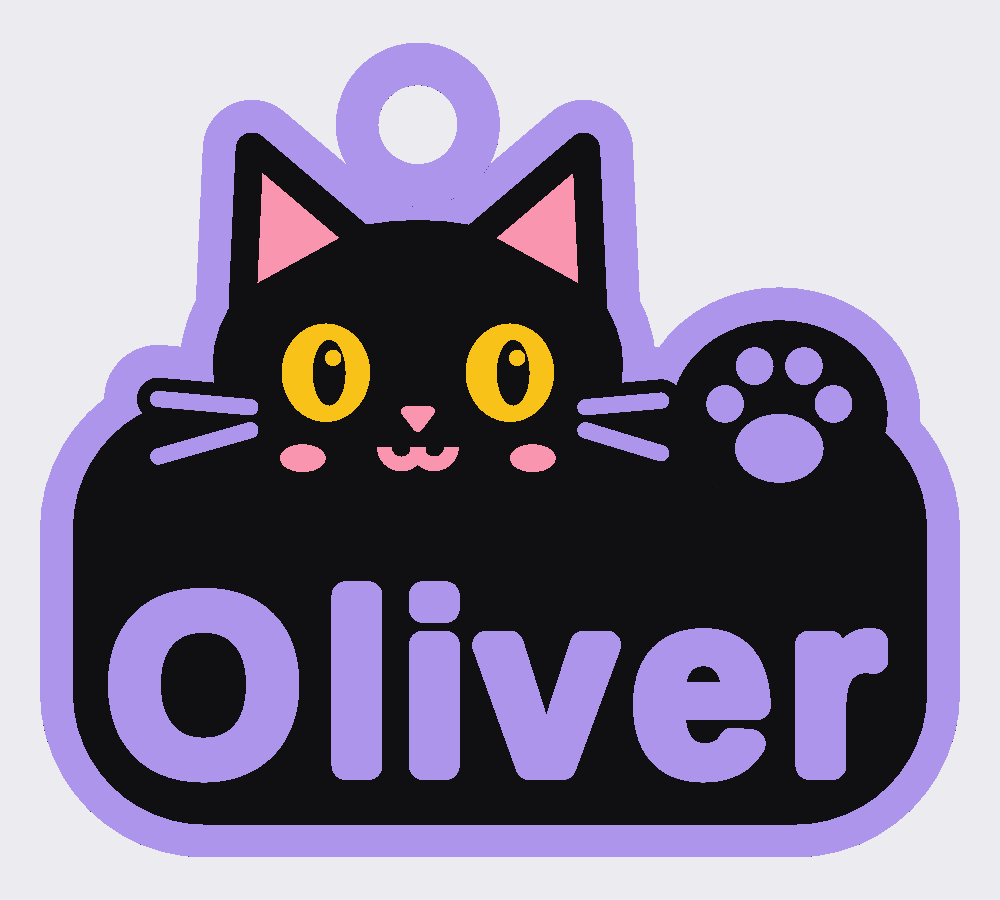

# 05 · Halloween Black Cat Keyring — 이름 위로 얼굴을 내민 검정 고양이 (4색 / 5색)

사진의 특징(귀 안쪽이 분홍인 검정 고양이, 노란 눈, 분홍 코·ω 입·볼터치, 수염, 발바닥 젤리가 있는 발, 굵은 연보라 이름,
연보라 테두리, 위쪽 고리)을 살려 **도형으로 새로 설계**한 키링입니다. 크기 **약 56 × 50 × 3.6 mm**.

## 어떤 세트를 쓰나요
| 세트 | 필라멘트 | 특징 |
|---|---|---|
| **4색 (기본)** | 연보라 · 검정 · 노랑 · 분홍 (AMS 1대) | 수염과 눈 하이라이트가 각각 연보라 / 노랑으로 나옴 |
| 5색 (선택) | 위 4개 + **흰색** | 사진처럼 흰 수염과 흰 눈 하이라이트. 필라멘트 5종 필요 |

## 파일 (압축 파일 안, 4색 기준)
| 파일 | 색 | 들어 있는 것 |
|---|---|---|
| `keyring_cat_4color.scad` | — | **OpenSCAD 원본**(색 지정 포함, 이름·크기·색 수 수정 가능) |
| `4color/1_lavender.stl` | 연보라 | 테두리, 고리, 이름, 발바닥 젤리, 수염 |
| `4color/2_black.stl` | 검정 | 판, 고양이 머리·귀·발, 동공 |
| `4color/3_yellow.stl` | 노랑 | 눈, 눈 하이라이트 |
| `4color/4_pink.stl` | 분홍 | 귀 안쪽, 코, 입, 볼터치 |
| `4color/onecolor_no_AMS.stl` | 한 색 | 전부 합친 단색 버전(AMS 없을 때, 칠해서 완성) |
| `5color/…` | | 5색 세트(`5_white.stl` = 수염·눈 하이라이트 추가) |

같은 세트의 STL은 **같은 좌표**라 함께 불러오면 제자리에 맞춰집니다. 4색과 5색 파일을 섞어 쓰지 마세요.

## Bambu Studio에서 출력 (AMS)
1. 한 세트의 STL을 **한꺼번에 선택**해서 끌어다 놓습니다.
2. "여러 부품을 하나의 객체로 불러오시겠습니까?" → **예**.
3. 부품마다 필라멘트 지정(연보라 / 검정 / 노랑 / 분홍 / 흰색).
4. 레이어 0.2mm, 서포트 끄기 → 슬라이스 → 출력.

## OpenSCAD에서 직접 (원본 파일)
- `part = "all"` → 미리보기(F5). `"lavender"` / `"black"` / `"yellow"` / `"pink"` / `"white"` → F6 → STL(색마다 한 번씩). `"onecolor"` → 단색.
- `use_white = true;` → 5색(흰 수염). 이때는 연보라·노랑 부품도 다시 내보내야 합니다.
- `name_text = "Oliver";` 에서 **이름 변경**. 글자 크기는 판 안에 자동으로 맞춰지고, 고양이에 닿지 않게 높이도 제한됩니다.
- 한글 이름: `font_name = "Malgun Gothic:style=Bold";` (Windows)
- 크기: `model_scale`. 높이(층)는 줄어들지 않게 x·y만 조절합니다.

## 구조 (층, 모두 0.2mm 배수)
연보라 테두리 0~1.6mm → 검정 1.6~2.8mm → 색 요소 2.8~3.6mm. 고리는 연보라가 2.8mm까지 올라가 튼튼합니다. 고리 구멍 4.8mm.
검정 고양이 머리·귀·발은 판보다 0.8mm 도드라져 있습니다. 눈동자는 노란 눈을 뚫어서 아래 검정이 보이게 한 것입니다.

## 검증 현황
**검증됨(수치)**: 4색·5색 모든 부품이 닫힌 메시(비다양체 모서리 0), 색 부품끼리 겹침 0(4색 6쌍, 5색 10쌍),
고리가 테두리와 한 덩어리로 이어짐, P2S 베드 안, 이름 7개(Oliver, Liam, Ava, Noah, Sophia, Alexander, Jo)가 판 안에 여백 1.8mm 이상으로 들어가고 고양이와 겹치지 않음.
**검증되지 않음**: 실제 출력 결과, AMS 색 전환 시 퍼지 양과 시간, 가장 가는 부분(수염·입 선 폭 약 0.9~1.0mm)의 출력 품질,
한글 폰트(이 환경에는 Malgun Gothic이 없어 시험 못 함), Bambu Studio 메뉴 이름(버전마다 다를 수 있음).
