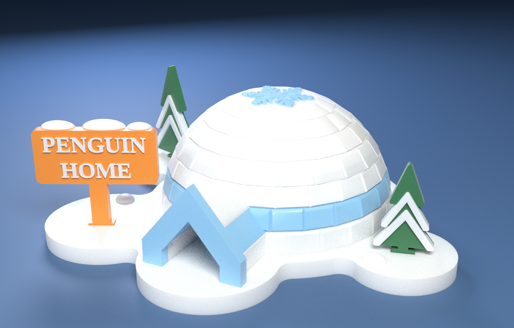
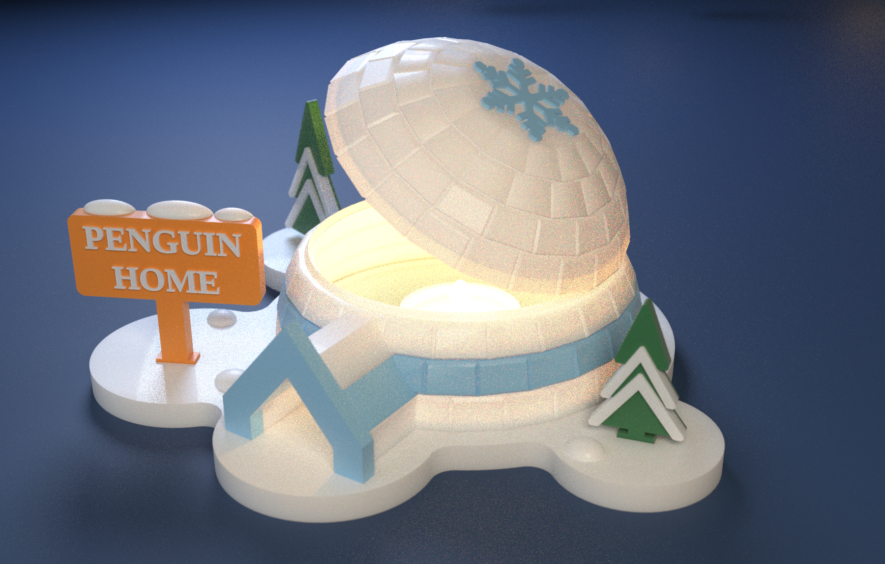
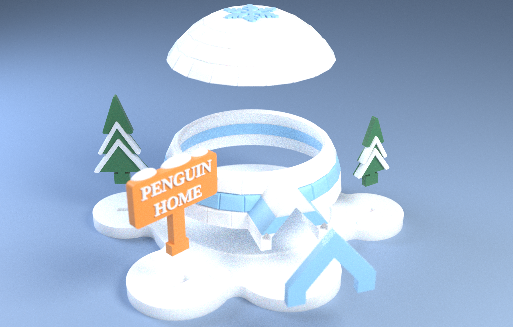
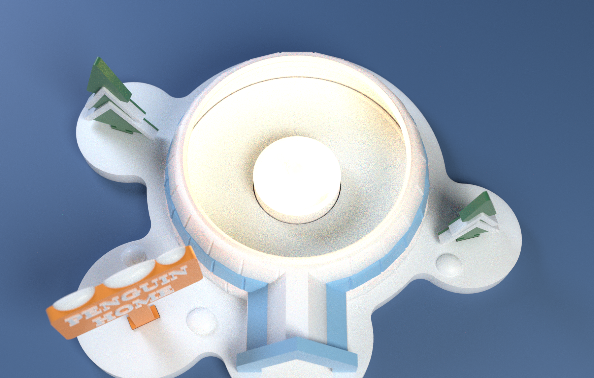
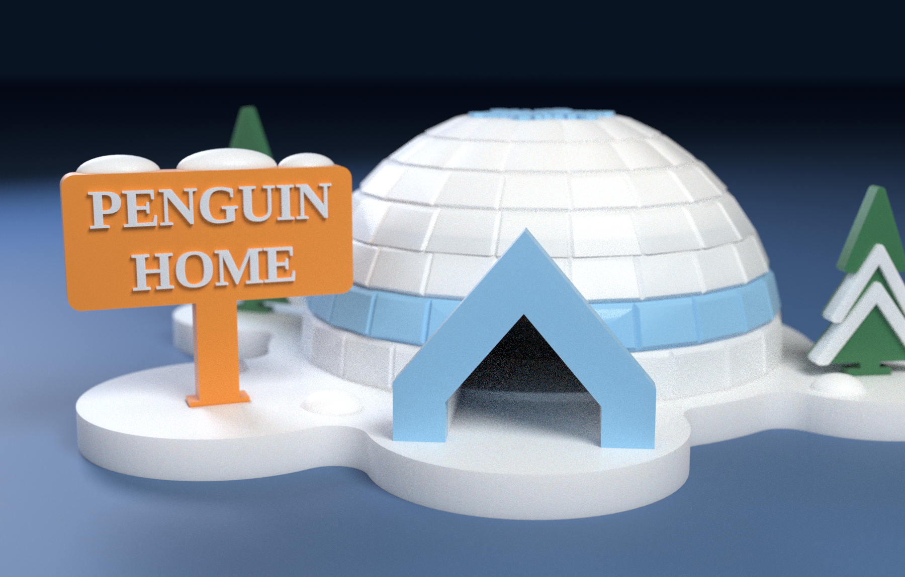

# 🐧 PENGUIN HOME — 얼음 블록 이글루 · LED 티라이트 랜턴

눈 덮인 바닥판 위의 이글루(뚜껑이 열리는 **수납함 겸 LED 티라이트 랜턴**), 입구의 블루 아치, "PENGUIN HOME" 팻말, 눈 덮인 소나무 둘.
OpenSCAD 로 만든 파라메트릭 모델이고, **서포트 없이** 출력되도록 모든 조각의 형태와 출력 방향을 설계했습니다.



| | |
|---|---|
| 크기 | 바닥판 196 × 167 mm, 이글루 지름 116 × 높이 54.5 mm (몸통 29 + 뚜껑 25.5), 문 28 × 24 mm, 가장 높은 소나무 61 mm |
| 구성 | 조각 7개 — 바닥판, 이글루 몸통, 뚜껑, 입구 아치 장식, 팻말, 소나무 2 (색 영역 13개) |
| 색 | White · Ice blue · Green · Orange (4색) |
| 프린트 | **베드 2장**(256 × 256 mm), 베드당 최대 4색 — 베드 1: White·Green·Orange, 베드 2: White·Blue |
| 서포트 | **0** — PrusaSlicer 자동 서포트(45°)로 두 베드 모두 확인(아래 “확인한 것”) |
| 바꿀 수 있는 것 | 팻말 글자(기본 `PENGUIN` / `HOME`), 끼움 여유 `tol`, 색 배정 |

---

## 1. 이 작품이 다른 점 (독창성)

참고 사진(둥근 벽돌 이글루)을 베끼지 않고 같은 *주제*를 **출력하기 쉬운 형태**로 다시 풀었습니다.

- **얼음 블록 이글루(저폴리)** — 반구를 위도 10° 간격의 7단으로 나누고, 각 단을 평평한 면(블록) 24~14개로 만들어 반 칸씩 어긋나게 쌓았습니다. 모서리마다 V 홈이 있어 ‘블록을 쌓은’ 모양이 그대로 보입니다. 부드러운 곡면이 아니라 **면으로 된 얼음 결정** 느낌이라 사진과 확실히 구분됩니다.
- **출력을 위한 형태** — 사진처럼 둥근 아치 입구는 천장이 허공 위에 놓여 서포트가 필요합니다. 여기서는 **뾰족한 40° 지붕(A자 문, 폭 32 × 높이 32 mm)** 으로 바꿨고, 뚜껑 위치 고정도 핀 대신 **V자 링**으로 해서 다리 놓을(브리지) 곳이 없습니다.
- **수납함 + 랜턴** — 뚜껑을 들면 바닥판의 **티라이트 홈**(지름 38 mm LED 티라이트용)이 있는 속이 드러납니다. 문과 열린 뚜껑 사이로 빛이 새어 나옵니다(글로우 렌더 참고).
- **넓은 입구** — 문은 폭 28 × 높이 24 mm 의 A자 아치라서 LED 티라이트의 빛이 문 밖으로 새어 나옵니다. 문을 키워도 서포트가 생기지 않도록 몸통 안쪽 벽을 19° 원뿔로 설계했습니다(아래 5장).
- **내 이름 팻말** — 글자는 변수(`sign_line1`, `sign_line2`)라 "PIXELFORM / PENGUINS" 처럼 바꿀 수 있습니다.
- **자체 디자인 눈 결정** — 뚜껑 위의 6갈래 눈 결정(가지 2쌍 + 끝 결정)은 이 모델 전용으로 그렸습니다.



---

## 2. 프린트 (베드 2장)

| 베드 | 슬롯 | 조각 | 점유율 | 예상 시간* | 필라멘트(g)* | 서포트 |
|---|---|---|---|---|---|---|
| **1** | White · Green · Orange | 바닥판, 팻말, 소나무 2 | 60 % | 7 h 49 m | 73 / 7 / 8 | 없음 |
| **2** | White · Blue | 이글루 몸통, 뚜껑, 입구 아치 장식 | 42 % | 8 h 25 m | 77 / 30 | 없음 |

\* PrusaSlicer 2.7 CLI 일반 프로파일(0.2 mm · 벽 3 · 인필 12 % · 프라임 타워 포함) 추정치입니다. 실제 기계에서는 달라집니다.
총량(대략): White 150 g · Blue 30 g · Orange 8 g · Green 7 g.


`beds/bedN.3mf` (색별 압출기 지정) 와 `beds/bedN/` (베드 좌표에 배치된 조각×색 STL, 파일명 끝이 색)이 있습니다.

### 출력 방법
1. 3MF 를 엽니다(안 열리면 `beds/bedN/` 의 STL 전부를 “여러 파트를 가진 하나의 오브젝트”로 불러와 파일명 끝의 색대로 필라멘트를 지정 — 위치는 이미 맞춰져 있으니 움직이지 마세요).
2. **조각을 회전·뒤집지 마세요.** 몸통은 입구가 옆으로 난 채 서 있고, 뚜껑은 평평한 면이 베드에 닿고, 나머지는 눕혀서 출력됩니다.
3. 서포트 **끔**, 브림 없음, 레이어 0.2 mm, 벽 3줄. 인필은 10~15 % 로 충분하지만 **뚜껑은 솔리드 덩어리**(약 120 cm³)라서 위쪽 솔리드 레이어를 4장 이상 주세요(둥근 윗면이 성긴 인필 위에 올라갑니다).
4. 프라임 타워는 뒤쪽 오른쪽 구석(x ≥ 207, y ≥ 183 mm 영역, 45 × 70 mm)을 비워 두었습니다. 베드 2는 2색이라 타워가 작습니다.
5. 베드 1(바닥판)이 가장 오래 걸립니다 — 바닥판은 8 mm 두께, 함께 올린 가장 높은 색 조각(팻말)도 6.4 mm 라 색 교환은 맨 아래 약 32층 안에서만 일어나고, 그 위는 한 가지 색(White)입니다.

---

## 3. 조립



| 순서 | 조각 | 방법 |
|---|---|---|
| 1 | 바닥판 | 가운데의 낮은 링(지름 104~108 mm)이 몸통 안쪽을 잡아 줍니다 |
| 2 | 이글루 몸통 | 링 바깥으로 얹기만 하면 됩니다 (바닥이 평평) |
| 3 | 입구 아치 장식(블루) | 터널 앞면의 홈 2개에 뒷면 핀 2개를 끼워 밀어 넣음(필요하면 접착) |
| 4 | **LED 티라이트** | 바닥판 가운데 홈(지름 38 mm)에 넣음 — 아래 안전 주의 |
| 5 | 뚜껑 | 몸통 테두리의 V자 링(폭 2.6 mm) 위에 얹음 — 뚜껑 밑면의 V홈이 0.3 mm 여유로 받아 줍니다(알아서 가운데가 맞음) |
| 6 | 팻말 · 소나무 2 | 각자의 탭을 바닥판 소켓에 위에서 끼움(여유 0.2 mm). 순서 무관 |

> ⚠️ **진짜 촛불을 넣지 마세요.** PLA 는 약 60 °C 에서 휘고 녹습니다. 반드시 LED 티라이트를 쓰세요.




---

## 4. 내 것으로 바꾸기

- **팻말 글자**: `openscad/penguin_home.scad` 맨 위의 `sign_line1`, `sign_line2`. 명령줄에서는 `SIGN1="PIXELFORM" SIGN2="PENGUINS" tools/build_all.sh`.
- **끼움 여유**: `tol`(기본 0.2 mm). 헐거우면 0.15, 뻑뻑하면 0.25.
- **색**: `tools/family_palette.py` 의 `BASE_ROLES`(예: `"sign.wood": "BLUE"`) 또는 `--palette my.json`. 베드는 자동으로 다시 짜입니다(베드 묶음은 `palettes/groups.json`).
- **배치**: `stand()` 의 좌표표(팻말·소나무 위치와 소켓)와 `MOUNDS`(눈 더미) — 바꾼 뒤 `check_fit.py` 로 겹침을 확인하세요.
- 전체 다시 만들기: `tools/build_all.sh` (`SKIP_RENDER=1` 렌더 생략, `SKIP_EXPORT=1` STL 재사용). 필요: OpenSCAD 2021.01+, Python 3 (`trimesh numpy shapely rtree manifold3d pillow`), Blender 4.x(렌더), PrusaSlicer(슬라이스 점검).

---

## 5. 확인한 것 / 확인하지 못한 것

**확인함** (`docs/PRINT_REPORT.md`, `docs/ASSEMBLY_REPORT.txt`, `beds/PLAN.md`)
- STL 13개 모두 닫힌 메시, 같은 조각 안의 색 영역끼리 겹침 0, **조각이 갈라진 파편 없음(뚜껑·몸통·아치 링 각각 한 덩어리)**, 뚜껑 홈 주변 바깥 껍질 ≥ 1.5 mm.
- **조각별 레이어 검사(0.2 mm, 45°): 오버행 0**, 완성 상태에서 서로 다른 조각끼리 겹침 0 (0.05 mm³ 기준).
- **PrusaSlicer 자동 서포트(45°)를 켜고 두 베드를 슬라이스: 서포트 0.** 프라임 타워는 베드 안, 모델과 12.8 mm 이상 떨어짐.
- 조립: 몸통·뚜껑·소켓에 꽂는 조각 전부 위로 곧게 들어 올려 뺄 수 있음(끼우는 순서 제약 없음), 탭은 바닥판 소켓에 5.6 mm 깊이로 0.2 mm 여유로 들어감, 아치 장식은 앞에서 밀어 넣어 붙음.

**설계하며 부딪힌 것 (고친 것)** — 같은 문제를 겪을 분을 위해 적어 둡니다.
- **뚜껑이 깨지고 몸통과 안 맞음**(사용자 지적, 슬라이서 화면에서 확인) — 문을 키우려고 몸통을 4단(37 mm)으로 올렸더니 뚜껑 가장자리가 45° 로 가팔라져, 뚜껑 밑면의 V홈이 바깥 껍질을 뚫고 나가 **얇은 고리(147 mm³)가 본체에서 떨어져 나간 STL** 이 되었습니다. 제 검사(닫힌 메시·오버행·겹침·서포트)는 모두 통과해서 놓쳤습니다. → 몸통을 다시 3단(29 mm)으로 돌리고, 링/홈을 작게(링 폭 2.6·높이 2.2 mm / 홈 폭 3.2·깊이 2.7 mm) 안쪽으로 붙여 **바깥 껍질이 1.5 mm 이상** 남게 했고, `check_pieces.py` 에 **한 덩어리인지(`--solid`)·얇은 벽이 없는지(`--wall`)** 검사를 넣었습니다(예전 깨진 뚜껑으로 시험해 걸러지는 것 확인).
- **문 크기**: 처음 문(폭 22 × 높이 19.6 mm)이 펭귄 모형이 지나가기엔 작다는 지적이 있어 한때 문을 32 × 32 mm 로 키웠으나(위 사고의 원인), 이후 요청으로 **펭귄과 펭귄용 바닥 소켓을 모델에서 뺐기 때문에** 문은 28 × 24 mm 로 정했습니다(처음보다 넓고, 3단 몸통에서 서포트 없이 만들 수 있는 크기).
- 문을 키우자 슬라이서가 **문 안쪽 끝에 서포트 기둥(약 0.6 m)** 을 세웠습니다 — 문 지붕(40° 기울기)과 안쪽 벽(최대 37° 기울기)이 만나는 모서리가 층마다 0.23 mm 씩 밀려 나와 45° 한계(0.2 mm)를 살짝 넘었기 때문입니다 → 안쪽 면을 곧은 원뿔(19°)로 바꿔 0 으로.
- 서로 다른 개수의 면을 어긋나게 쌓으면 모서리 턱(0.5 mm)이 생겨 슬라이서가 **이글루 안쪽에 21 m 가 넘는 서포트 기둥**을 세웠습니다 → 위 단을 아래 단의 내접원 안에서 시작하게 하고 안쪽 면을 매끈한 원뿔로 바꿔 0 으로.
- 터널 지붕이 몸통 테두리보다 높이 올라가 허공에 뜬 부분이 생겼음 → 테두리 아래로 제한.
- 핀 구멍이 뚜껑 얇은 가장자리를 뚫을 뻔함 → 핀 대신 연속 V자 링.
- 몸통 바닥 홈(턱)은 몸통이 베드에서 떠 버려 서포트가 생김 → 홈 대신 바닥판의 낮은 링으로 바꿈.

**확인하지 못함 — 읽고 판단하세요**
- **실제로 출력해 보지 않았습니다.** 0.2 mm 끼움 여유, 작은 글자(팻말 0.9 mm 높이), 뚜껑 윗면의 인필 위 처짐은 프린터마다 다를 수 있습니다.
- 3MF 는 PrusaSlicer 형식이고 PrusaSlicer 2.7 에서만 열어 확인했습니다. Bambu Studio / OrcaSlicer 가져오기는 시험하지 못했습니다(위 STL 방법 사용).
- 시간·필라멘트 수치는 일반 프로파일 추정치이며, 슬라이서가 정말 서포트를 안 쓰는지는 위의 방법(자동 서포트 점검)으로만 확인했습니다 — 다른 슬라이서의 설정에서는 달라질 수 있습니다.
- 뚜껑 틈으로 새어 나오는 빛의 세기(글로우 렌더)는 연출입니다. PLA 의 실제 투과 정도는 필라멘트에 따라 다릅니다.
- 렌더는 Blender 시각화이며 실제 필라멘트의 색·광택과 다릅니다.

---

## 6. 폴더

```
openscad/penguin_home.scad      파라메트릭 모델 (part = 조각 이름, layout = assembled | local)
stl/print/                      조각×색 STL, 출력 자세 (13개 + manifest/config)
stl/assembled/                  조각×색 STL, 완성품 좌표 (조립 확인·렌더용)
beds/                           bed1~2.3mf, bedN/ (베드 좌표에 배치된 STL), PLAN.md, plan.json, slice_summary.json
renders/                        hero · glow · exploded · closeup · top · bed1~2
docs/                           PRINT_REPORT.md, ASSEMBLY_REPORT.txt
palettes/groups.json            어떤 조각을 어느 베드에 올릴지
slicer/prusaslicer_4color_256.ini   256 × 256, 4색 점검용 최소 프로파일
tools/                          export_roles · plan_beds · check_pieces · check_fit · check_assembly · slice_check · render_scene · compose_beds · write_plan_md · build_all.sh
blender/render_showcase.py      Cycles 렌더러(headless)
```
