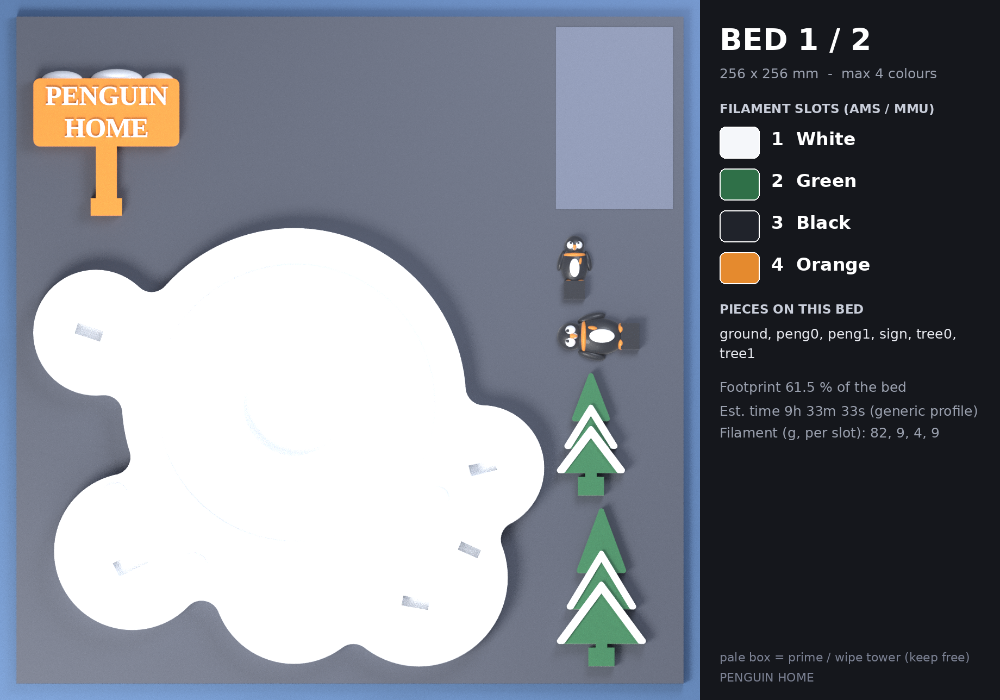
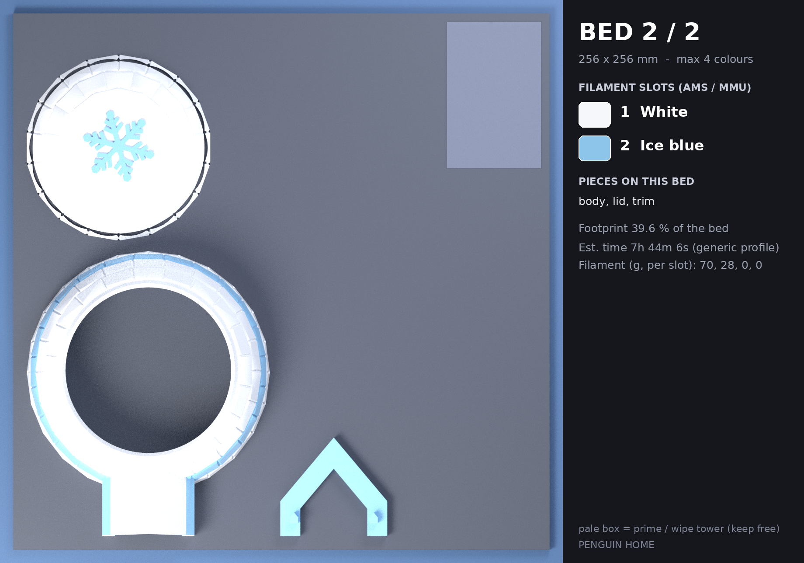

# 프린트 베드 계획 — PENGUIN HOME

베드 256 × 256 mm, 베드당 최대 4색. 조각 하나의 모든 색은 같은 베드에서 출력됩니다.

| 베드 | 필라멘트 슬롯 | 조각 | 베드 점유율 | 예상 시간* | 필라멘트(g)* | 서포트 |
|---|---|---|---|---|---|---|
| **1** | WHITE · GREEN · BLACK · ORANGE | 6 | 61.5 % | 9h 33m 33s | 82 / 9 / 4 / 9 | 없음 |
| **2** | WHITE · BLUE | 3 | 39.6 % | 7h 44m 6s | 70 / 28 | 없음 |

\* PrusaSlicer 2.7 CLI, 0.4 mm 노즐 · 0.2 mm 레이어 · 벽 3 · 인필 12 % · 프라임 타워 포함(`slicer/prusaslicer_4color_256.ini`). 일반 프로파일 추정치라 실제 기계에서는 달라집니다. g 은 슬롯 순서이며 색 교환 퍼지 분량이 포함됩니다.

## 베드 1

| 슬롯 | 색 | HEX | 순수 모델 부피 |
|---|---|---|---|
| 1 | WHITE (흰색) | `#F5F7FA` | 187.2 cm³ |
| 2 | GREEN (초록) | `#2F7048` | 4.7 cm³ |
| 3 | BLACK (검정) | `#20232B` | 1.0 cm³ |
| 4 | ORANGE (주황) | `#E58A2E` | 9.7 cm³ |

| 조각 | 의미 | 색 구성 |
|---|---|---|
| `ground` | 눈 덮인 바닥판(티라이트 홈 + 소켓) | 눈=WHITE |
| `peng0` | 펭귄(어른) | 몸=BLACK, 배=WHITE, 얼굴 무늬=WHITE, 눈=BLACK, 부리=ORANGE, 발=ORANGE, 목도리=ORANGE |
| `peng1` | 펭귄(아기) | 몸=BLACK, 배=WHITE, 얼굴 무늬=WHITE, 눈=BLACK, 부리=ORANGE, 발=ORANGE, 목도리=ORANGE |
| `sign` | 팻말 | 나무 판=ORANGE, 글자=WHITE, 눈=WHITE |
| `tree0` | 소나무 | 잎=GREEN, 눈=WHITE |
| `tree1` | 소나무 | 잎=GREEN, 눈=WHITE |

- 슬라이서 자동 서포트 점검(45°): **서포트 없음**
- 프라임 타워: x 210.5–248.5, y 183.5–247.5 mm (모델과 11.6 mm 이상 떨어짐, 베드 안: 예)
- 색 교환: 슬롯 T0, T1, T2, T3 사용

## 베드 2

| 슬롯 | 색 | HEX | 순수 모델 부피 |
|---|---|---|---|
| 1 | WHITE (흰색) | `#F5F7FA` | 117.6 cm³ |
| 2 | BLUE (아이스 블루) | `#8CC4EA` | 28.6 cm³ |

| 조각 | 의미 | 색 구성 |
|---|---|---|
| `body` | 이글루 몸통(얼음 블록 7단 중 아래 4단, 입구 터널 포함) | 얼음 블록=WHITE, 블루 띠=BLUE |
| `lid` | 이글루 뚜껑(솔리드, 눈 결정) | 얼음 블록=WHITE, 눈 결정=BLUE |
| `trim` | 입구 아치 장식(블루) | 아치 링=BLUE |

- 슬라이서 자동 서포트 점검(45°): **서포트 없음**
- 프라임 타워: x 209.8–249.2, y 182.5–203.5 mm (모델과 96.0 mm 이상 떨어짐, 베드 안: 예)
- 색 교환: 슬롯 T0, T1 사용

