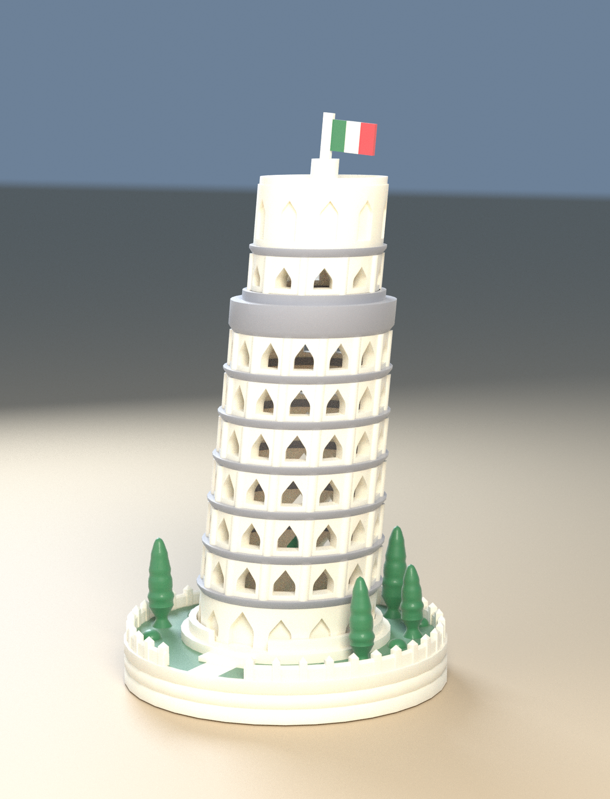
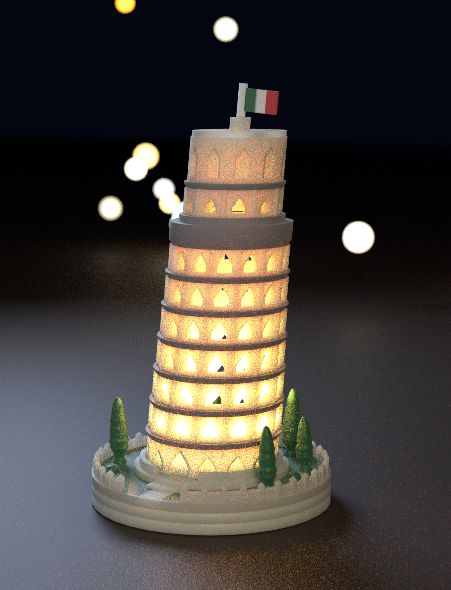
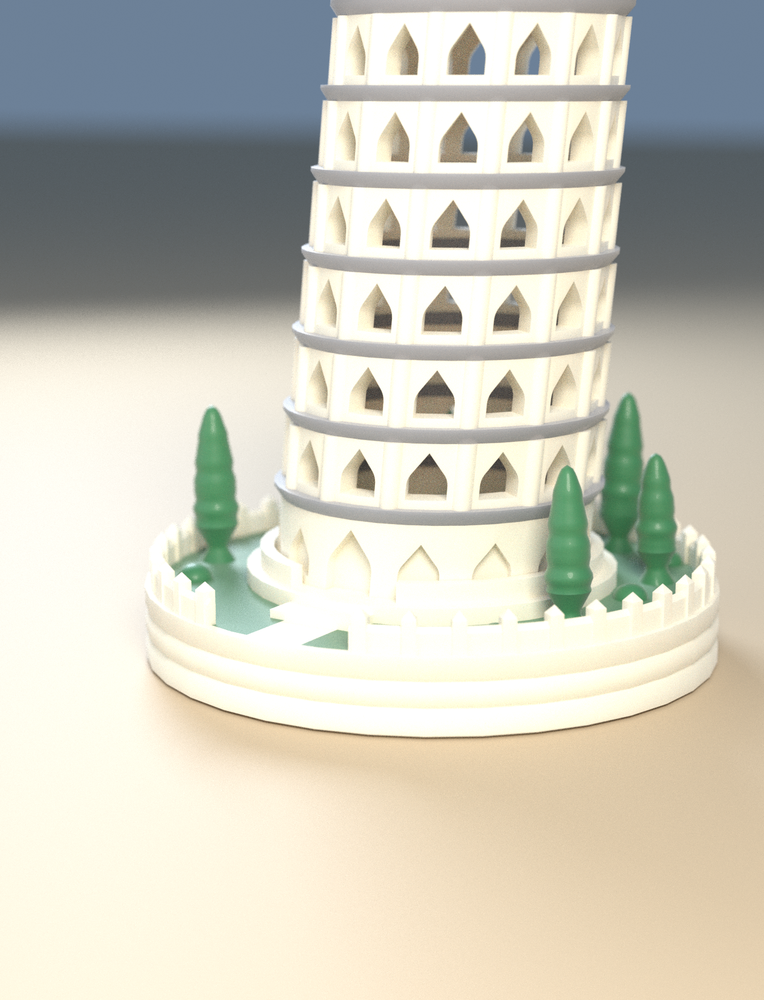
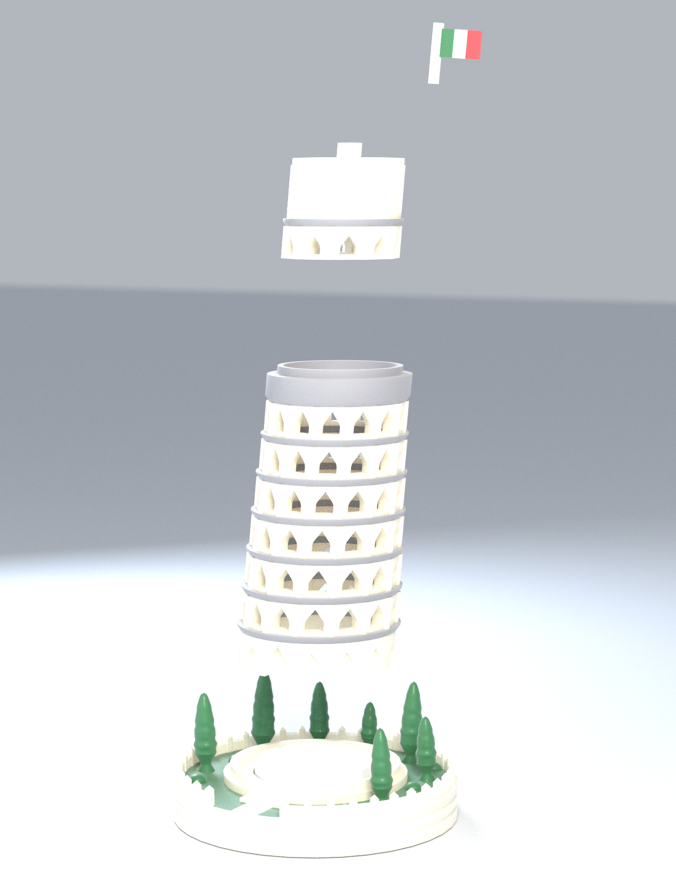
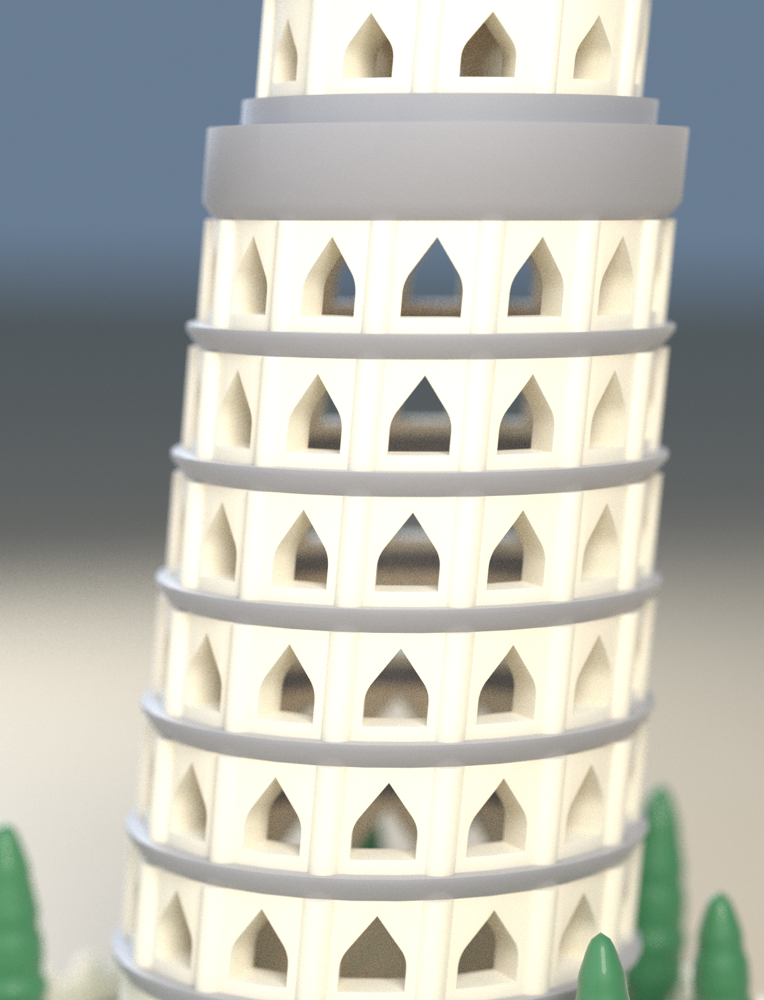

# 🏛️ LEANING TOWER OF PISA — 피사의 사탑 LED 티라이트 램프

사진의 디자인(분리 출력 3조각 + 이탈리아 국기 + 조경이 있는 바닥 베이스 + LED 티라이트 조명)을 OpenSCAD 로 새로 모델링했습니다.
**서포트 없이** 출력되도록 모든 곡면·아치·지붕의 기울기를 설계했고, **최대 4색**(아이보리 · 그레이 · 초록 · 빨강)으로 베드 2장에 나눠 출력합니다.



| | |
|---|---|
| 크기 | 가로 × 세로 **88 × 88 mm**(바닥), 높이 **151 mm**(깃발 끝까지) — 사진의 “약 150 × 80 mm” 와 같은 크기 |
| 구성 | 조각 4개 — 바닥 베이스, 타워 본체(속이 빔), 상단부(종탑·지붕·깃대 꽂는 구멍), 깃대 + 이탈리아 국기(한 장짜리 납작한 조각) (색 영역 9개) |
| 색 | **4색** — Ivory(돌) · Gray(층 사이 띠) · Green(잔디·나무·국기) · Red(국기) |
| 프린트 | **베드 2장**(256 × 256 mm): 베드 1 = 베이스 + 국기(Ivory·Green·Red), 베드 2 = 타워 + 상단부(Ivory·Gray) |
| 서포트 | **0** — PrusaSlicer 자동 서포트(45°)로 두 베드 모두 확인 |
| 조명 | 지름 38 mm 이하 LED 티라이트(별도 구매)를 베이스의 홈에 넣으면 불빛이 아치 창으로 새어 나옵니다 |
| 바꿀 수 있는 것 | 기울기 `LEAN`, 층당 아치 수 `N_ARC`, 크기, 끼움 여유 `tol`, 색 배정 |





---

## 1. 사진과 같은 점 · 만든 방식

- **사진처럼 3조각 + 국기** — 베이스(조경 포함) / 타워(속이 빔, LED 설치 가능) / 상단부(지룡) 로 나눠 출력하고 끼웁니다. **깃대와 국기는 납작한 한 장으로 따로 출력해 상단부 지붕의 작은 구멍에 꽂습니다**(접착 불필요, 헐거우면 한 방울).
- **1층 + 아케이드 6층 + 종탑** — 층마다 아치 14개(위로 갈수록 2.3 % 씩 가늘어짐), 층 사이에는 그레이 코니스 띠. 1층은 벽 속으로 판 **막힌 아치(벽감)와 정문**, 2~7층은 **벽을 뚫은 아치 창**이라 불빛이 나옵니다. 아치 사이에는 기둥(원기둥) 부조.
- **조경 베이스** — 잔디, 돌 광장, 정문으로 이어지는 계단과 길, 뾰족 지붕 기둥이 달린 낮은 울타리, **사이프러스 7그루**(가늘고 길쭉한 타원형, 둥근 꼭대기, 불규칙한 잎 덩어리, 살짝 기울어짐 — 원뿔처럼 뾰족하지 않게)와 덤불 7개, 돌 쌓은 옆면 줄눈.
- **LED 티라이트** — 베이스 가운데 홈(지름 38.8 mm, 깊이 9 mm). 티라이트가 타워 안 빈 공간으로 3.5 mm 올라와 위쪽까지 빛이 퍼집니다. (실제 촛불은 쓰지 마세요 — PLA 는 약 60 °C 에서 휩니다.)

### 서포트를 없애기 위한 설계
| 문제 | 해결 |
|---|---|
| 기울어진 탑은 층마다 허공에 뜰 것 같다 | 기울기를 **전단(shear)** 으로 만들어 모든 층이 그냥 원이고 층마다 0.02 mm 만 옆으로 밀립니다(5.5°). 오버행 없음 |
| 둥근 아치 천장은 허공 위에 놓인다 | 아치를 “**둥근 어깨 + 뾰족 머리**”로 — 지름의 원호로 38°까지 올라간 뒤 접선 방향 직선으로 정점까지. 어디서도 38° 이상 기울지 않음(전단 포함 최대 약 41°) |
| 코니스(층 띠) 아랫면은 옆으로 튀어나온다 | 아랫면을 36° 기울기의 모따기로 |
| 타워 꼭대기 → 종탑 사이, 종탑 지붕 속은 평평한 천장 | 둘 다 **원뿔**(깔때기 · 지붕 속 원뿔, 기울기 38°)로 — 다리 놓을 곳이 없음 |
| 울타리 가로대는 기둥 사이 허공 | 가로대 대신 **연속된 낮은 벽**(뾰족한 윗면)과 기둥 |
| 나무 | 뾰족한 원뿔 대신 **둥근 타원형 수관**: **굵은 줄기(지름 3.4 mm)와 퍼진 발(5.6 mm, 잔디에 1 mm 박힘)** 위에서 29° 로 퍼져 나가 키의 1/4 높이에서 가장 넓고, 위로는 둥글게 닫힘. 잎 덩어리의 굴곡은 모두 25° 미만이라 서포트가 필요 없음 |
| 끼움 | 가는 홈 대신 낮은 **세로 고리(칼라)** 로 — 타워는 베이스의 고리 안에, 상단부는 타워 위의 고리 안에 서고, 꽂히는 곳 벽은 얇아지지 않음 |

---

## 2. 프린트 (베드 2장)

| 베드 | 슬롯 | 조각 | 점유율 | 예상 시간* | 필라멘트(g)* | 서포트 |
|---|---|---|---|---|---|---|
| **1** | Ivory · Green · Red | 베이스, 깃대+국기 | 12 % | 4 h 19 m | 31 / 12 / 1 | 없음 |
| **2** | Ivory · Gray | 타워, 상단부 | 6 % | 8 h 33 m | 59 / 20 | 없음 |

\* PrusaSlicer 2.7 CLI 일반 프로파일(0.2 mm · 벽 3 · 인필 12 % · 프라임 타워 포함) 추정치입니다. 실제 기계에서는 달라집니다. 총량(대략): Ivory 90 g · Gray 20 g · Green 12 g · Red 1 g.


`beds/bedN.3mf`(색별 압출기 지정) 와 `beds/bedN/`(베드 좌표에 배치된 조각×색 STL, 파일명 끝이 색)이 있습니다. 두 베드는 **한 판에 모두 올려도 들어가는 크기**지만(색 4개), 12 시간이 넘는 한 번의 출력이 되므로 나눠 두었습니다.

### 출력 방법
1. 3MF 를 엽니다(안 열리면 `beds/bedN/` 의 STL 전부를 “여러 파트를 가진 하나의 오브젝트”로 불러와 파일명 끝의 색대로 필라멘트를 지정 — 위치는 이미 맞춰져 있으니 움직이지 마세요).
2. **조각을 회전·뒤집지 마세요.** 타워는 비스듬히 선 채 그대로(바닥이 평평), 상단부도 세운 채, 깃대+국기는 눕혀서 출력됩니다.
3. 서포트 **끔**, 레이어 0.2 mm, 벽 3줄, 인필 10~15 %. (깃대+국기는 두께 1.2 mm 의 납작한 한 장이라 6 레이어입니다.) 타워는 높고 가늘어 흔들릴 수 있으니 **바닥 안착을 위해 브림 3~5 mm 를 권장**합니다(모델에는 포함하지 않았습니다 — 슬라이서에서 켜세요).
4. 색 교환: 타워는 코니스 띠 7줄(층당 약 11 레이어)에서만, 베이스는 맨 아래 약 6 mm(잔디·울타리) 와 나무 구간에서만 일어납니다. 프라임 타워는 뒤쪽 오른쪽 구석을 비워 두었습니다.

---

## 3. 조립



| 순서 | 조각 | 방법 |
|---|---|---|
| 1 | LED 티라이트 | 베이스 가운데 홈에 넣음 |
| 2 | 타워 | 베이스의 낮은 고리 안에 그냥 세움(여유 0.4 mm, 정문이 고리의 틈 쪽을 향함) |
| 3 | 상단부 | 타워 맨 위 고리 안에 얹음 |
| 4 | 깃대 + 국기 | 깃대의 발(2.8 × 1.2 mm)을 지붕 위 작은 원기둥의 구멍(3.2 × 1.6 mm, 깊이 5.5 mm)에 위에서 꽂음. 구멍이 탑처럼 5.5° 기울어 있으니 **탑이 기운 쪽(오른쪽)으로 살짝 기울여** 꽂으세요 |



---

## 4. 내 것으로 바꾸기

`openscad/pisa_tower.scad`
- `LEAN` — 기울기(기본 5.5°). 8° 로 올려도 타워·상단부 서포트 0 임을 슬라이서로 확인했습니다(그 이상은 확인하지 않았습니다). 바꾼 뒤에는 `tools/build_all.sh` 의 검사를 다시 돌리세요.
- `N_ARC`(층당 아치 수, 기본 14), `FH`(층 높이), `NF`(아케이드 층수), `TAPER`(위로 갈수록 가늘어지는 정도).
- `POCKET_R`·`POCKET_D` — 티라이트 홈. **내 티라이트가 38 mm 보다 크면 `POCKET_R` 을 키우세요**(기본 19.4 = 지름 38.8).
- `TREES`·`BUSHES`·`FENCE_R` — 조경 배치.
- 색: `tools/family_palette.py` 의 `BASE_ROLES` 또는 `--palette my.json`. 베드는 자동으로 다시 짜입니다(묶음은 `palettes/groups.json`).
- 전체 다시 만들기: `tools/build_all.sh` (`SKIP_RENDER=1` 렌더 생략, `SKIP_EXPORT=1` STL 재사용). 필요: OpenSCAD 2021.01+, Python 3 (`trimesh numpy shapely rtree manifold3d pillow`), Blender 4.x(렌더), PrusaSlicer(슬라이스 점검).
- OpenSCAD 에서 열면 전체를 렌더하는 데 1~2분이 걸립니다(제 환경 OpenSCAD 2021.01 에서 77초, 경고 없음)(`part="tower"` 처럼 조각 하나만 내보내면 수 초).

---

## 5. 확인한 것 / 확인하지 못한 것

**확인함** (`docs/PRINT_REPORT.md`, `docs/ASSEMBLY_REPORT.txt`, `beds/PLAN.md`)
- STL 9개(색 영역) 모두 닫힌 메시, 같은 조각 안의 색 영역끼리 겹침 0, 완성 상태에서 서로 다른 조각끼리 겹침 0.
- **조각별 레이어 검사(0.2 mm, 45°): 오버행 0** (네 조각 모두).
- **PrusaSlicer 자동 서포트(45°)를 켜고 두 베드를 슬라이스: 서포트 0.** 프라임 타워는 베드 안, 모델과 145 mm 이상 떨어짐.
- 타워·상단부는 **갈라진 파편 없이 한 덩어리**(색 영역마다), 타워 벽에 1.4 mm 보다 얇은 곳 없음(`check_pieces.py --solid --wall`).
- 조립: 타워·상단부는 위로 곧게 들어 올려 빠지고, 깃대는 기운 축을 따라 곧게 빠짐(그 방향으로 당겨 빼 봄).

**설계하며 부딪힌 것 (고친 것)**
- 처음 만든 울타리 가로대(기둥 사이를 잇는 막대)가 허공에 떠서 슬라이서가 **5 m 가 넘는 서포트**를 만들었습니다 → 가로대를 연속된 낮은 벽으로 바꿔 0 으로.
- 깃발 꽂는 방식은 세 번 바뀌었습니다: ① 깃대에 홈을 파고 국기를 끼움(홈의 평평한 천장 때문에 서포트가 생겼음) → ② 홈을 없애고 국기를 깃대 옆면에 접착 → ③ **(최종, 요청)** 깃대와 국기를 납작한 한 장으로 출력해 지붕의 구멍에 꽂음. 구멍은 위가 열린 수직 구멍이라 천장이 없고, 납작하게 눕혀 뽑는 깃대는 레이어 방향이 길이 방향이라 세워서 뽑는 것보다 훨씬 덜 부러집니다.
- 레이어 검사 도구가 단면을 뜰 때 절단면이 꼭짓점에 아주 가까우면 외곽선 하나를 빠뜨려 **없는 오버행(324 mm³)을 보고**했습니다 → 단면을 manifold3d 로 뜨도록 바꿨습니다(슬라이서 결과와 일치).
- 이전 프로젝트(PENGUIN HOME)에서 뚜껑이 깨져 나온 일을 교훈 삼아, **끼움을 얇은 홈이 아닌 낮은 고리로** 하고 “한 덩어리인지·얇은 벽이 없는지” 검사를 기본 빌드에 넣었습니다.

**확인하지 못함 — 읽고 판단하세요**
- **실제로 출력해 보지 않았습니다.** 높이 92 mm 의 가늘고 긴 타워(벽 4.5 mm, 아치 창 94개)가 흔들리지 않고 올라가는지, 0.2 mm 끼움 여유, 깃대(2.8 × 1.2 mm 납작한 막대)의 강도는 프린터마다 다를 수 있습니다. 깃대는 부러지기 쉬우니 접착을 권합니다.
- 사진의 탑은 층당 아치가 30개 안팎이고 둥근 아치·세밀한 기둥머리가 있습니다. 0.4 mm 노즐로 서포트 없이 뽑기 위해 **아치를 14개 / 둥근 어깨 + 뾰족 머리**로 단순화했습니다(사진과 똑같지는 않습니다).
- 티라이트 크기는 지름 38 mm · 높이 12.5 mm 이하로 가정했습니다. 다른 크기는 `POCKET_R` / `POCKET_D` 로 맞추세요.
- 3MF 는 PrusaSlicer 형식이고 PrusaSlicer 2.7 에서만 열어 확인했습니다. Bambu Studio / OrcaSlicer 가져오기는 시험하지 못했습니다(위 STL 방법 사용).
- 시간·필라멘트 수치는 일반 프로파일 추정치이며, 서포트가 정말 없는지는 위의 방법(자동 서포트 점검)으로만 확인했습니다 — 다른 슬라이서·설정에서는 달라질 수 있습니다.
- 렌더는 Blender 시각화이며(PLA 의 빛 투과·색은 필라멘트에 따라 다릅니다) 실제 모습과 다릅니다.

---

## 6. 폴더

```
openscad/pisa_tower.scad        파라메트릭 모델 (part = base | tower | top | flag, layout = assembled | local)
stl/print/                      조각×색 STL, 출력 자세 (9개 + manifest/config)
stl/assembled/                  조각×색 STL, 완성품 좌표 (조립 확인·렌더용)
beds/                           bed1~2.3mf, bedN/ (베드 좌표에 배치된 STL), PLAN.md, plan.json, slice_summary.json
renders/                        hero · night · exploded · detail · garden · bed1~2
docs/                           PRINT_REPORT.md, ASSEMBLY_REPORT.txt
palettes/groups.json            어떤 조각을 어느 베드에 올릴지
slicer/prusaslicer_4color_256.ini   256 × 256, 4색 점검용 최소 프로파일
tools/                          export_roles · plan_beds · check_pieces · check_fit · check_assembly · slice_check · render_scene · compose_beds · write_plan_md · build_all.sh
blender/render_showcase.py      Cycles 렌더러(headless)
```
