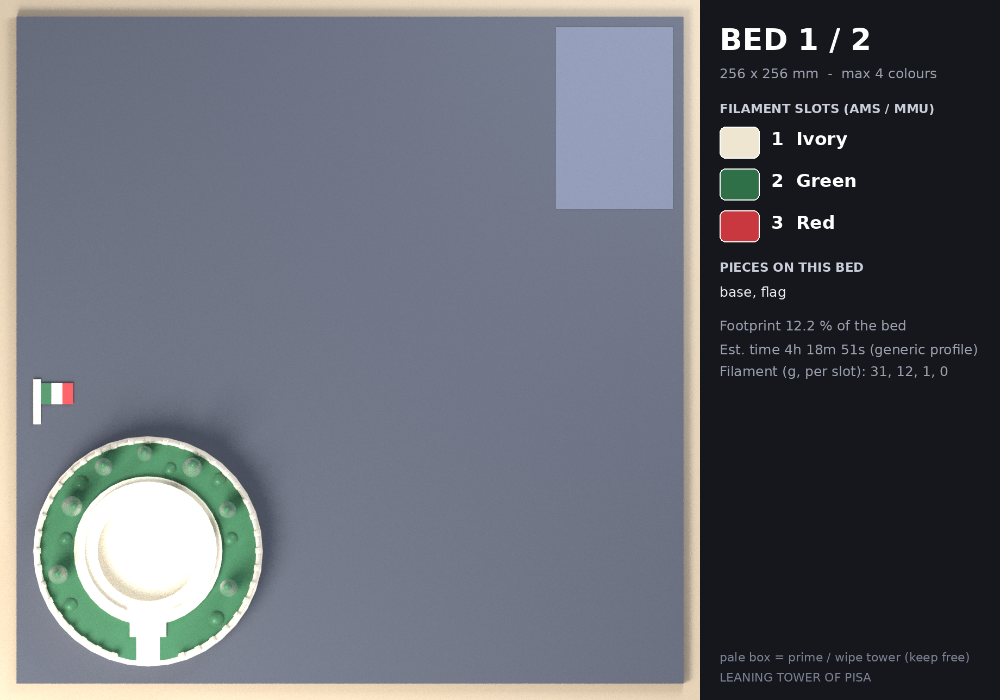
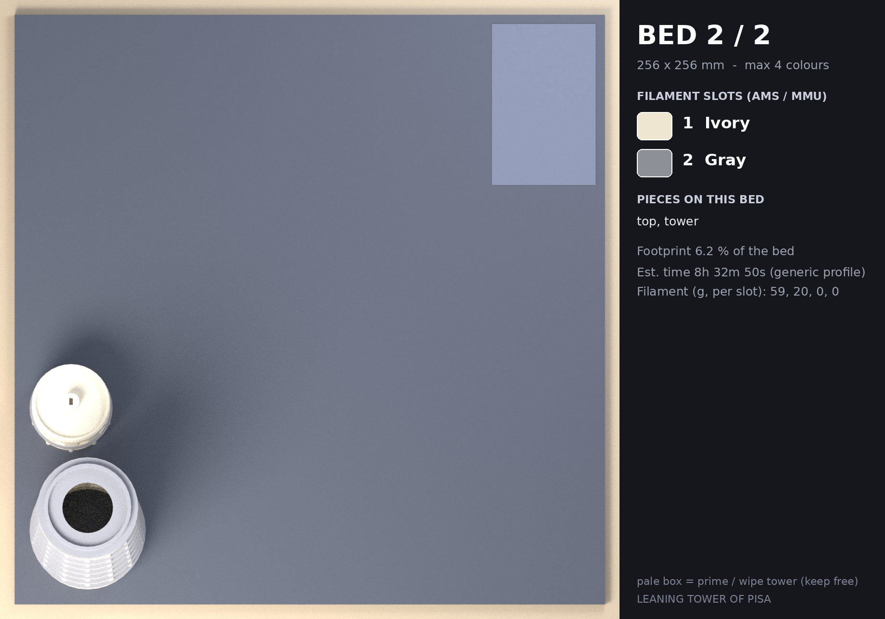

# 프린트 베드 계획 — LEANING TOWER OF PISA

베드 256 × 256 mm, 베드당 최대 4색. 조각 하나의 모든 색은 같은 베드에서 출력됩니다.

| 베드 | 필라멘트 슬롯 | 조각 | 베드 점유율 | 예상 시간* | 필라멘트(g)* | 서포트 |
|---|---|---|---|---|---|---|
| **1** | IVORY · GREEN · RED | 2 | 12.2 % | 4h 18m 51s | 31 / 12 / 1 | 없음 |
| **2** | IVORY · GRAY | 2 | 6.2 % | 8h 32m 50s | 59 / 20 | 없음 |

\* PrusaSlicer 2.7 CLI, 0.4 mm 노즐 · 0.2 mm 레이어 · 벽 3 · 인필 12 % · 프라임 타워 포함(`slicer/prusaslicer_4color_256.ini`). 일반 프로파일 추정치라 실제 기계에서는 달라집니다. g 은 슬롯 순서이며 색 교환 퍼지 분량이 포함됩니다.

## 베드 1

| 슬롯 | 색 | HEX | 순수 모델 부피 |
|---|---|---|---|
| 1 | IVORY (아이보리) | `#EFE6D2` | 61.8 cm³ |
| 2 | GREEN (초록) | `#2F7048` | 6.7 cm³ |
| 3 | RED (빨강) | `#C8383E` | 0.0 cm³ |

| 조각 | 의미 | 색 구성 |
|---|---|---|
| `base` | 바닥 베이스(잔디·광장·계단·울타리·나무 + LED 티라이트 홈) | 돌(본체)=IVORY, 잔디·나무 / 초록 줄=GREEN |
| `flag` | 이탈리아 국기(납작하게 출력) | 잔디·나무 / 초록 줄=GREEN, 흰 줄=IVORY, 빨간 줄=RED |

- 슬라이서 자동 서포트 점검(45°): **서포트 없음**
- 프라임 타워: x 209.8–249.2, y 183.5–225.0 mm (모델과 145.7 mm 이상 떨어짐, 베드 안: 예)
- 색 교환: 슬롯 T0, T1, T2 사용

## 베드 2

| 슬롯 | 색 | HEX | 순수 모델 부피 |
|---|---|---|---|
| 1 | IVORY (아이보리) | `#EFE6D2` | 44.0 cm³ |
| 2 | GRAY (그레이) | `#8E9098` | 18.1 cm³ |

| 조각 | 의미 | 색 구성 |
|---|---|---|
| `top` | 상단부(종탑·지붕·깃대) | 돌(본체)=IVORY, 층 사이 띠(코니스)=GRAY |
| `tower` | 타워 본체(1층 + 아케이드 6층, 속 빔) | 돌(본체)=IVORY, 층 사이 띠(코니스)=GRAY |

- 슬라이서 자동 서포트 점검(45°): **서포트 없음**
- 프라임 타워: x 209.5–249.5, y 182.0–204.0 mm (모델과 184.8 mm 이상 떨어짐, 베드 안: 예)
- 색 교환: 슬롯 T0, T1 사용

