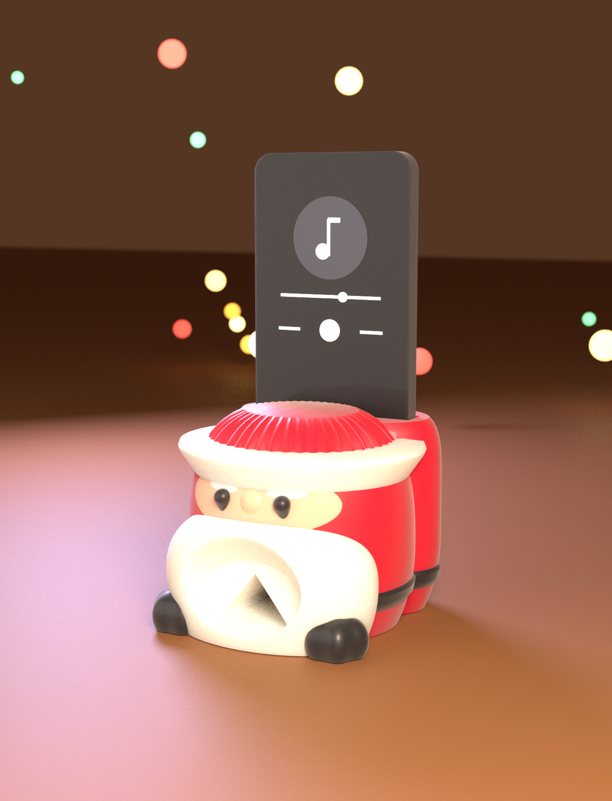
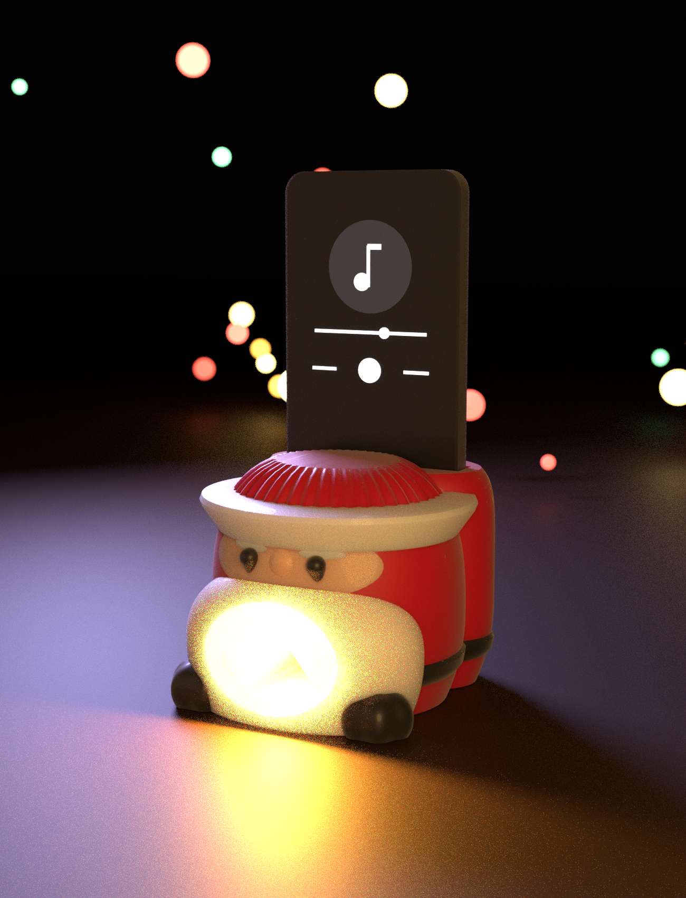
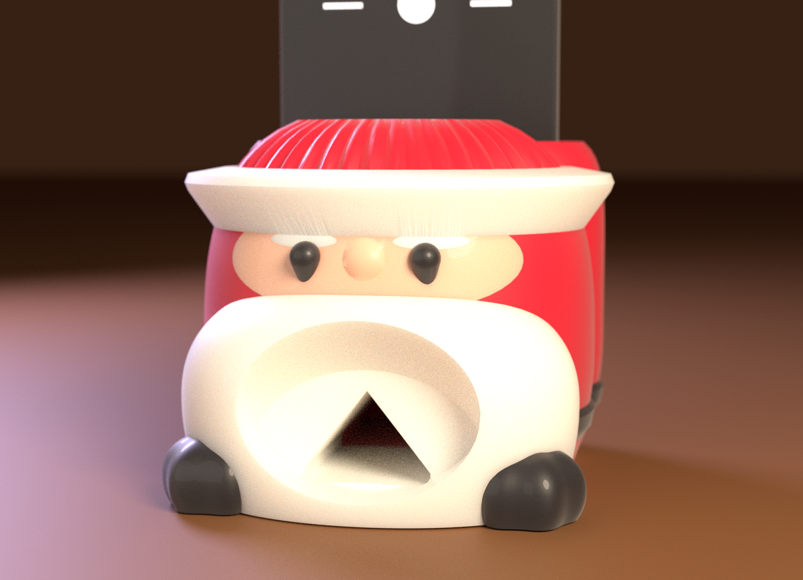
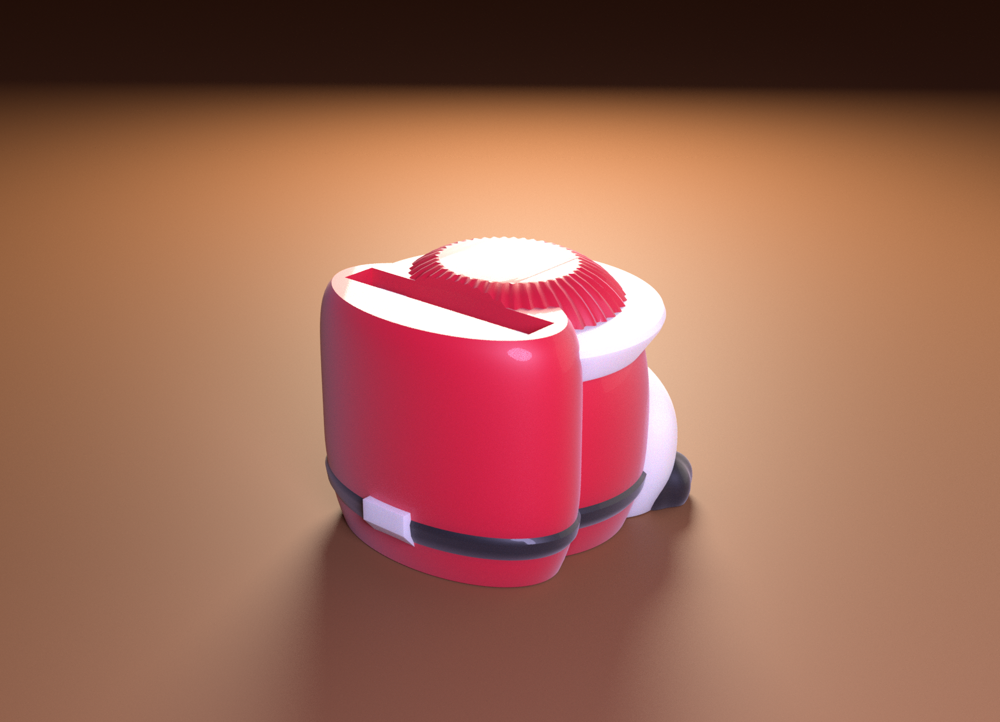
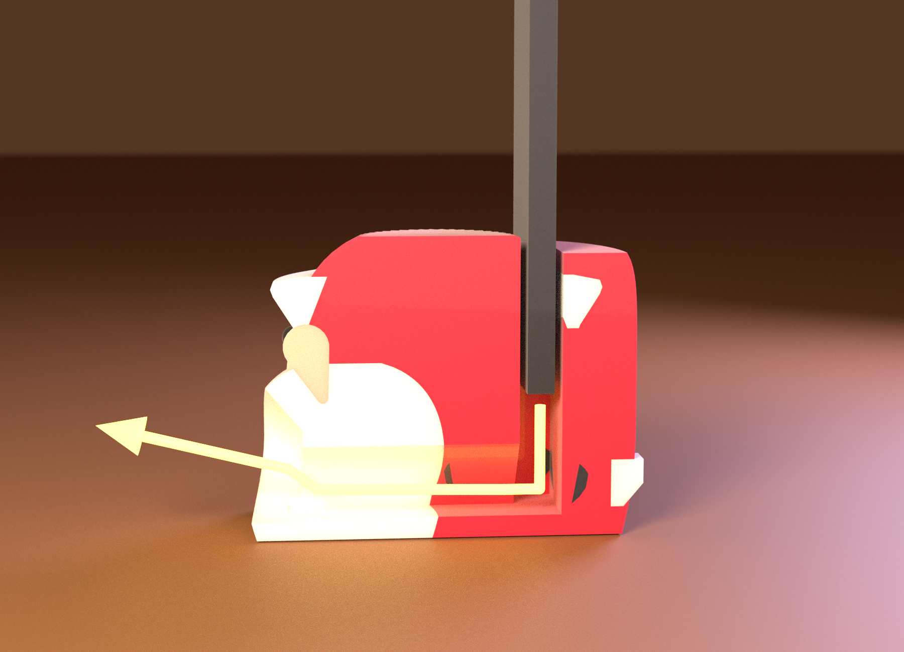
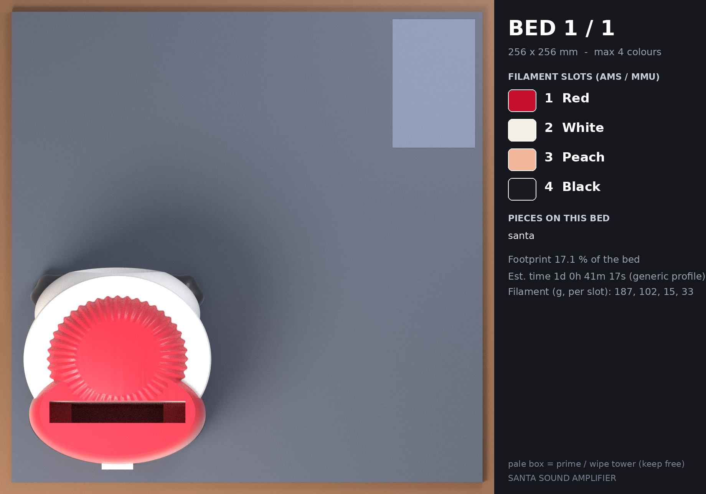
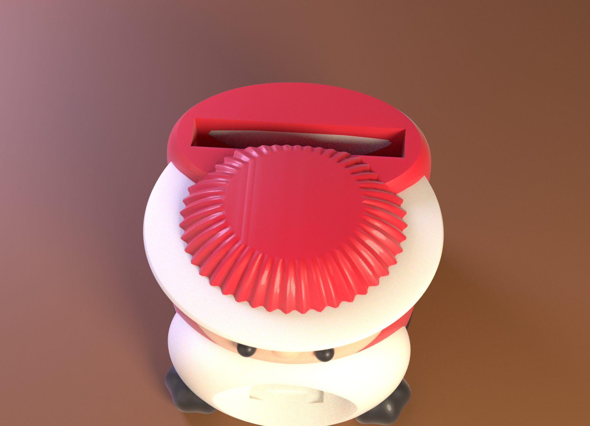

# 🎅 SANTA SOUND AMPLIFIER — 산타 소리 증폭기

사진 속 디자인(뜨개 모자를 쓴 둥근 산타, 수염 속 나팔 입, 모자 뒤에 폰을 꽂는 슬롯, 검은 부츠와 벨트, 방울)을 OpenSCAD 로 새로 모델링했습니다.
호박 증폭기와 같은 원리 — *폰 슬롯 → 소리 챔버 → 목구멍 → 나팔 → 입* — 의 전원 없는 **패시브 증폭기**이고,
**자르지 않은 한 덩어리**를 서 있는 자세 그대로 **서포트 없이** 출력합니다.



| | |
|---|---|
| 크기 | 폭 약 **102 mm**, 앞뒤 약 **110 mm**, 높이 **85 mm**(모자 꼭대기) · 폰을 꽂으면 바닥에서 약 **187 mm** |
| 구성 | **한 덩어리** — 둥근 머리·몸(뜨개 모자 돔) + 뒤쪽의 모자 꼬리(폰 슬롯) + 수염 + 나팔 입 + 눈·코·눈썹 + 털 챙 + 방울 + 부츠 2개 + 벨트·버클 |
| 색 | **4색** — 빨강(몸·모자) · 흰색(수염·털 챙·방울·눈썹·버클) · 살구(얼굴·코) · 검정(눈·부츠·벨트). **한 가지 색으로도 출력 가능**(아래 “출력”) |
| 서포트 | **0** — PrusaSlicer 자동 서포트(45°) 점검 결과 (4색판·1색판 모두) |
| 폰 투입구 | **74 × 12 mm**, 깊이 40 mm (맨몸 또는 얇은 케이스의 아이폰 13: 71.5 × 7.65 mm 기준) |
| 소리 길 | 챔버(폭 50 mm) → 목구멍·나팔(폭 28 mm의 곧은 관, 단면 300 mm²) → 수염 속 **오목하게 벌어지는 입**(앞에서 본 창 폭 52 × 높이 약 38 mm, 약 4,770 mm²) |
| 프린트 | 베드 1장(256 × 256 mm), 점유율 약 19 %. **1색 약 8~9.5 시간 / 4색 약 24.7 시간** |



---

## 1. 사진과 같은 점 · 다른 점

| 사진 | 이 모델 |
|---|---|
| 둥글고 통통한 산타, 빨간 몸 | ✅ 달걀 모양(아래가 평평하게 잘림) 몸·머리, 바닥에 검은 벨트 |
| 빨간 뜨개 모자(돔) + 흰 털 챙 + 방울 | ✅ 돔에 세로 뜨개 골(44줄), 흰 털 챙(아랫면 55° 경사), 돔 위의 흰 방울 — **방울은 사진처럼 옆이 아니라 꼭대기**에 있습니다(옆에 매달리면 서포트가 필요) |
| 살구색 얼굴, 검은 구슬 눈, 분홍 코, 흰 눈썹, 볼 | ✅ 얼굴(살구색 면), 구슬 눈, 둥근 코, 눈썹(면에 칠한 흰 무늬). 볼의 분홍은 없음 |
| 곱슬곱슬 구름 같은 큰 흰 수염 | ✅ 큰 흰 수염 덩어리 — **곱슬 질감과 털 챙의 땋은 무늬는 없고 매끈**합니다 |
| 수염 한가운데의 큰 나팔(깊은 둥근 깔때기) | ⚠️ 수염 속의 **얕게 벌어지는 타원형 입** + 뒷벽의 목구멍 구멍. 깊은 원형 나팔은 위쪽 천장이 수평이 되어 서포트가 필요해서 이렇게 바꿨습니다 |
| 뒤에서 폰을 꽂는 슬롯 | ✅ 몸 뒤쪽의 **모자 꼬리**(둥글고 높은 덩어리) 윗면에 슬롯 |
| 검은 부츠 2개, 벨트와 금색 버클(뒷면) | ✅ 검은 부츠 2개, 벨트, 버클은 뒷면(흰색 — 금색은 5번째 색이라 뺐습니다) |
| 크기 90 × 75 × 100 mm | 약 102 × 85 × 110 mm — 폰 슬롯(74 mm)이 들어가야 해서 조금 큽니다 |



---

## 2. 서포트 없이 — 설계

몸을 호박과 같은 방법으로 설계하고, 튀어나온 부분은 모두 “아래쪽이 가파른 면”이 되게 했습니다.

| 부분 | 해결 |
|---|---|
| 둥근 몸·부츠·수염 | 달걀 모양을 아래에서 잘라 바닥에서 37° 이하로 퍼짐 |
| 폰 슬롯 | 슬롯이 74 mm 로 넓어서 윗면이 그만큼 평평하고 넓어야 합니다. 둥근 머리 돔 위에는 그런 윗면이 안 나오므로 **머리 뒤에 높고 윗면이 평평한 모자 꼬리**를 따로 두고 거기에 슬롯을 팠습니다(사진의 뒷모습과 비슷) |
| 챔버 | 슬롯의 아래쪽 연장이라 천장이 없음 |
| 목구멍 | 폭 28 mm 로 곧은 A 자 지붕(38.7°) 관 — 폭이 천천히 변하면 지붕 꼭대기 선이 거의 수평이 되어 서포트가 생기므로 일정하게 |
| 입 | 바닥은 위를 향하는 둥근 그릇, 천장은 **뒤쪽 뒷벽으로 갈수록 낮아지는 40° 경사면**(확성기 모양)이라 레이어마다 단단한 뒷벽에서 앞으로 0.17 mm 씩 자라 나옴 |
| 털 챙 | 아랫면이 55° 로 기운 고리. **머리 표면에서 딱 붙어 시작**(0.5 mm 만 튀어나와도 고리 전체를 서포트로 받치려 합니다) |
| 코·눈 | 아래로 가파른 원뿔이 달린 “방울” 모양(공 + 원뿔) |
| 눈썹·얼굴 | 튀어나오지 않은 **표면 위의 색 무늬**(튀어나온 판은 아랫단이 허공) |
| 방울 | 돔 위에 반쯤 묻힌 공 |
| 벨트·버클 | 벨트는 1.3 mm 만 튀어나오고 위아래가 경사면, 버클 판은 아랫면이 50° |



---

## 3. 소리는 어떻게 나가나



1. 폰을 **화면이 앞(수염 쪽)을 보게** 모자 꼬리의 슬롯에 세워 꽂습니다. 폰의 아래쪽 모서리가 투입구 바닥(z = 40 mm)에 얹히고, 그 아래가 **빈 챔버**입니다.
2. 챔버(폭 50 mm)의 소리가 앞쪽의 **곧은 목구멍·나팔 관**(폭 28 mm, 길이 약 60 mm)을 지나 수염 속 입의 뒷벽 구멍으로 나옵니다.
3. 입은 뒷벽에서 앞으로 갈수록 **위로 벌어지는** 확성기 모양이라 소리가 앞으로 퍼집니다.

---

## 4. 프린트

| 판 | 필라멘트 | 예상 시간* | 필라멘트* | 서포트 |
|---|---|---|---|---|
| **4색** `beds/bed1.3mf` | 빨강 · 흰색 · 살구 · 검정 | **약 24 h 41 m** | 빨강 187 g · 흰색 102 g · 살구 15 g · 검정 33 g (프라임 타워 포함) | 없음 |
| **1색** `beds_1color/bed1.3mf` | 한 가지 색(빨강으로 지정) | 9 h 30 m | 157 g | 없음 |

\* PrusaSlicer 2.7 CLI 일반 프로파일(0.4 mm 노즐 · 0.2 mm 레이어 · 벽 3 · 인필 12 %) 추정치입니다. 실제 기계에서는 달라집니다.
**1색판은 인필을 줄이면 더 줄어듭니다**: 인필 8 % → 약 8 h 25 m / 132 g, 6 % → 약 8 h 01 m / 121 g.

**4색판이 하루가 넘게 걸리는 이유**: 얼굴·수염·털 챙·부츠·벨트의 색이 거의 모든 높이에 섞여 있어 **레이어마다 색을 여러 번 바꾸기** 때문입니다.
시간과 필라멘트를 아끼려면 **1색판**으로 뽑고 눈·코·얼굴·수염을 붓으로 칠하거나, 슬라이서에서 색을 하나로 합치세요. 흰색·검정만 바꿔도(빨강·살구를 한 색으로) 시간이 꽤 줄어듭니다.



`stl/print/` 의 STL 은 **이미 출력 자세**입니다(서 있는 자세 그대로, 색마다 한 개: `santa__red / white / peach / black.stl`).

### 출력 방법
1. 3MF 를 엽니다. 안 열리면 STL 4개를 “여러 파트를 가진 하나의 오브젝트”로 불러와 파일명 끝의 색대로 필라멘트를 지정하세요(위치는 이미 맞춰져 있으니 움직이지 마세요). 1색으로 뽑으려면 네 파트에 같은 필라멘트를 지정하면 됩니다.
2. **회전·뒤집기 금지.**
3. 서포트 **끔**, 레이어 0.2 mm. **벽은 4줄 이상**을 권합니다(챔버·관의 벽이 두꺼울수록 새지 않음), 윗면 5층, 인필 6~10 %.
4. 폰 둘레의 틈을 막으세요(“폰에 맞추기” 참고).

---

## 5. 폰에 맞추기 · 내 것으로 바꾸기

`openscad/santa_horn.scad` 맨 위:

```
phone_w = 74;   // 투입구 폭   (아이폰 13 = 71.5 mm, 맨몸 또는 얇은 케이스)
phone_t = 12;   // 투입구 두께 (아이폰 13 = 7.65 mm + 케이스, 꼭 맞게)
slot_d  = 40;   // 폰이 모자 꼬리 속으로 들어가는 깊이
```

- **폰이 투입구보다 얇으면 소리가 샙니다.** 맨몸 폰이면 둘레에 약 **231 mm²** 의 틈이 남습니다(검사 도구 계산). 투입구 둘레에 **스펀지 테이프**를 붙이거나 `phone_t = 9.2` 로 줄이세요. **두꺼운 케이스에는 맞지 않습니다** — 슬롯이 넓어지면 모자 꼬리(`RR`·`RZT`)도 넓히고, 모자 꼬리 윗면의 폭이 슬롯 폭보다 6 mm 이상 커야 합니다.
- `FR`·`FZC`·`FZL`·`FZU`·`FZT` — 머리·몸 크기. `FZL / FZC` 가 아래쪽 기울기(37°)를 정하니 바꾸면 서포트가 생길 수 있습니다.
- `MX`·`MZC`·`MZH`·`ROOM`·`RK` — 입의 폭·높이·깊이·천장 기울기. **입 뒷벽의 천장 높이(`MZC + MZH - RK × ROOM` ≈ 31 mm)는 목구멍 지붕(꼭대기 ≈ 26.5 mm)보다 높아야** 합니다. `RK` 를 1.0 아래로 내리면 서포트가 생길 수 있습니다.
- `BRIM_Z`·`HAT_N`·`HAT_A` — 털 챙 높이, 뜨개 골의 수·깊이.
- 바꾼 뒤에는 `tools/build_all.sh` 의 검사를 다시 돌리세요. 필요: OpenSCAD 2021.01+, Python 3 (`trimesh numpy scipy shapely rtree manifold3d pillow`), Blender 4.x(렌더), PrusaSlicer(슬라이스 점검).
- OpenSCAD 2021.01 로 색 4개를 모두 내보내는 데 약 1분 45초(가장 큰 빨강이 약 100초).



---

## 6. 확인한 것 / 확인하지 못한 것

**확인함** (`docs/PRINT_REPORT.md`, `docs/AIRPATH_REPORT.txt`, `beds/PLAN.md`, `beds_1color/`)
- STL 4개(색 4개) 모두 닫힌 메시, 부피 빨강 378 · 흰색 163 · 살구 3 · 검정 21 cm³(합 565 cm³), 빨강은 **한 덩어리**.
- **레이어 검사(0.2 mm, 45°, 출력 자세): 오버행 0 mm³.**
- **PrusaSlicer 자동 서포트(45°)를 켜고 슬라이스: 서포트 0** (4색판·1색판 모두).
- **공기 길 검사** (`tools/check_airpath.py`, 0.6 mm 복셀): 폰 둘레를 막으면 챔버의 공기는 **입으로만** 나옵니다. 관을 판으로 막으면 어디로도 새지 않아 **다른 구멍이 없습니다.**
  단면적: 목구멍 300 → 관 300 → 관 끝 304 → 입 약 4,770 mm².

**설계하며 부딪힌 것 (고친 것)** — 서포트 점검을 “지도”처럼 쓰며 하나씩 없앴습니다.
- 처음에는 몸이 **통 모양**이었습니다(폭 74 mm 슬롯이 들어가는 평평한 윗면 때문에). → 머리(둥근 돔)와 모자 꼬리(슬롯)를 나눈 두 달걀로 바꿔 산타처럼 보이게.
- **털 챙**: 아랫면이 45° 정확히이고 머리에서 0.5 mm 떨어져 시작해, 슬라이서가 몸 둘레 전체를 바닥부터 서포트로 세웠습니다(약 12 m, 40 g) → 55° 로 가파르게 하고 머리 표면에서 딱 붙여 시작.
- **버클·벨트**: 아랫면이 평평하거나 45° → 50° 이상의 경사로.
- **얼굴**: 몸 앞면에 얹은 살구색 판은 아래 테두리가 2.5 mm 튀어나와 서포트 → 표면과 같은 높이의 “색 무늬(껍질 3.5 mm)”로.
- **눈썹·눈·코**: 튀어나온 판/구슬의 앞쪽 아래가 얕은 각 → 눈썹은 색 무늬로, 눈·코는 거의 수직으로 내려가는 원뿔을 단 공 모양으로.
- **방울**: 옆에 붙이면 바깥쪽 아랫면이 허공 → 돔 위에 반쯤 묻힌 공으로.
- **입**: 호박에서 배운 대로 천장이 **뒷벽으로 갈수록 낮아지는** 경사(확성기) — 반대 방향은 앞쪽 가장자리가 허공에서 시작해 서포트가 입 안을 채웁니다.

**확인하지 못함 — 읽고 판단하세요**
- **실제로 출력하거나 소리를 재 보지 않았습니다.** “소리가 얼마나 커지는지”(음압, dB)는 **측정하지 않았습니다.** 공기 길이 이어지는지만 확인했습니다.
  이런 패시브 증폭기는 보통 **전혀 증폭하지 않고 소리의 방향을 앞으로 모아 주는 정도**이고, 곧은 28 mm 관이 입에서 한 번에 넓어지는 구조라 **저음은 거의 늘지 않습니다.** 큰 소리를 기대하지는 마세요.
- 사진의 **뜨개 무늬·땋은 털 챙·곱슬 수염·깊은 둥근 나팔**은 재현하지 못했습니다(서포트 없이 뽑으려고 매끈하게 단순화). 사진과 완전히 같은 모양은 아닙니다.
- 서포트가 정말 없는지는 PrusaSlicer 자동 서포트(45°)로만 확인했고, 다른 슬라이서·설정에서는 달라질 수 있습니다. 털 챙 아랫면(55°)·입 천장(40° 기울기)은 한계에 가깝습니다.
- 4색 출력(약 25 시간, 프라임 타워 포함 약 340 g)은 실제 AMS/MMU 에서 레이어마다 색을 바꾸므로 실패 가능성이 큽니다. 1색 출력 후 칠하기를 권합니다.
- 폰 둘레의 틈(231 mm²)과 케이스 두께는 폰마다 다릅니다.
- 3MF 는 PrusaSlicer 형식이고 PrusaSlicer 2.7 에서만 열어 확인했습니다. **Bambu Studio / OrcaSlicer 가져오기는 시험하지 못했습니다**(위 STL 방법 사용).
- 렌더는 Blender 시각화입니다(PLA 색·빛 투과는 필라멘트에 따라 다릅니다). 폰은 단순한 막대 모형이고 화면 그림은 설명용이며, 소리 화살표도 설명용 그림입니다.

---

## 7. 폴더

```
openscad/santa_horn.scad        파라메트릭 모델 (part = santa | all | phone | manifest)
stl/print/                      santa__red · white · peach · black .stl (서 있는 출력 자세) + manifest/config
stl/assembled/                  같은 STL (공기 길 검사·렌더용)
beds/                           bed1.3mf (4색), bed1/, PLAN.md, plan.json, slice_summary.json
beds_1color/                    bed1.3mf (한 가지 색), bed1/, slice_summary.json
renders/                        hero · night · face · side · section · top · bed1
docs/                           PRINT_REPORT.md, AIRPATH_REPORT.txt
palettes/                       groups.json, one_color.json (1색판)
slicer/prusaslicer_4color_256.ini   256 × 256 점검용 최소 프로파일
tools/                          export_roles · plan_beds · check_pieces · check_airpath · slice_check · render_scene · compose_beds · write_plan_md · build_all.sh
blender/render_showcase.py      Cycles 렌더러(headless)
```
